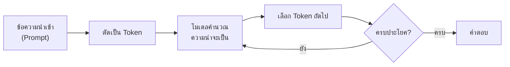

# บทที่ 1: ความรู้พื้นฐานปัญญาประดิษฐ์
*(What Is AI, Where It Came From, and How It Got Here)*

> [!info] ข้อมูลบทเรียน
> | รายการ | รายละเอียด |
> | :--- | :--- |
> | รายวิชา | `21909-2009` การใช้งานแอปพลิเคชันปัญญาประดิษฐ์ |
> | หน่วยการเรียนรู้ | หน่วยที่ 1 — ความรู้พื้นฐานเกี่ยวกับ AI และโมเดลภาษาขนาดใหญ่ (LLMs) |
> | สัปดาห์ | **สัปดาห์ที่ 1** (4 ชั่วโมง) |
> | หัวข้อตามโครงการสอน | ปฐมนิเทศ · ภาพรวม AI ยุคใหม่ · การกำเนิด Generative AI |
> | สมรรถนะที่มุ่งหวัง | อธิบายความหมาย ที่มา และวิวัฒนาการของ AI พร้อมยกตัวอย่างการใช้งานได้ |
> | กิจกรรม | ทดสอบก่อนเรียน + ทดลองใช้งาน ChatGPT และ Google Gemini เบื้องต้น |

> [!abstract] สาระสำคัญของบท (Key Takeaways)
> 1. **AI ไม่ใช่สิ่งใหม่** — รากความคิดมีมาตั้งแต่ยุคกรีก แต่เพิ่งมีชื่อเรียกอย่างเป็นทางการเมื่อปี **1956** ที่การประชุม Dartmouth
> 2. **AI คือสหวิทยาการ** — เกิดจากการรวมตัวของปรัชญา ตรรกศาสตร์ คณิตศาสตร์ ประสาทวิทยา ภาษาศาสตร์ และวิทยาการคอมพิวเตอร์
> 3. **AI = ข้อมูล + ขั้นตอนวิธี + กำลังประมวลผล** — สูตร 3 อย่างที่ทำให้ AI ยุคนี้ต่างจากยุคก่อนอย่างสิ้นเชิง
> 4. **ประวัติ AI ไม่ได้เดินเป็นเส้นตรง** — มีทั้งยุคทองและ "ฤดูหนาวของ AI" (AI Winter) ถึง 2 ครั้ง บทเรียนสำคัญคือ *ความคาดหวังที่เกินจริงนำมาซึ่งความผิดหวัง*
> 5. **Generative AI** เป็นคลื่นลูกที่ 4 ของ AI — ไม่ได้แค่ "จำแนก" แต่ "สร้าง" เนื้อหาใหม่ได้

---

## 1. บทนำ: ทำไมต้องรู้จัก AI ก่อนใช้ AI

ในชีวิตประจำวันของเรา AI ได้แทรกซึมเข้ามาโดยที่เราแทบไม่รู้ตัว — การจัดลำดับวิดีโอใน YouTube, การแนะนำสินค้าใน Shopee, การกรองอีเมลขยะ, การแปลภาษาบนมือถือ, หรือแม้แต่กล้องวงจรปิดที่ตรวจจับใบหน้าได้

แต่เมื่อถามว่า **"AI คืออะไร?"** คำตอบที่ได้มักวนอยู่กับภาพในหนังฮอลลีวูด — หุ่นยนต์ที่คิดเองได้, ระบบที่ conspire เพื่อยึดโลก, หรือกล่องวิเศษที่ตอบทุกคำถามได้

ปัญหาคือ **ภาพจำที่ผิด** เหล่านี้ ทำให้เรา:

* ประเมินความสามารถของ AI **สูงเกินจริง** (เชื่อทุกคำตอบโดยไม่ตรวจสอบ)
* ประเมินความเสี่ยง **ต่ำเกินไป** (ใส่ข้อมูลส่วนตัวลงไปโดยไม่คิด)
* และที่สำคัญที่สุด — **ไม่เห็นว่าเบื้องหลังมันทำงานอย่างไร** จึงใช้มันได้ไม่เต็มศักยภาพ

> [!quote] ถ้อยคำที่ควรจำ
> *"ถ้าเรารู้ว่าอะไรอยู่ใต้ฝากระโปรง เราจะขับรถได้ดีขึ้น และซ่อมมันได้เมื่อมันเสีย"*
> การรู้ประวัติและหลักการของ AI ไม่ได้มีไว้สอบ แต่มีไว้**ตัดสินใจ**ว่าควรเชื่อ ควรใช้ หรือควรตรวจซ้ำ

### 1.1 เส้นทางของรายวิชานี้ (Roadmap 18 สัปดาห์แบบย่อ)

|   ช่วง    | หัวข้อ                                | สิ่งที่นักเรียนจะทำได้                     |
| :-------: | :------------------------------------ | :----------------------------------------- |
|  **1–3**  | พื้นฐาน AI, LLM, Token & Context      | เข้าใจว่า AI ทำงานอย่างไรและมีข้อจำกัดอะไร |
|  **4–5**  | Prompt Engineering                    | สั่งงาน AI ได้อย่างมีโครงสร้าง             |
|  **6–7**  | Embedding & Semantic Search           | เข้าใจการค้นหาเชิงความหมายและ RAG          |
|  **8–9**  | OpenCode & Cloud Free Models          | ใช้ AI ระดับ developer ได้                 |
| **10–15** | Skills, Tool Calling, Agents, Harness | สร้างและทดสอบ Agent                        |
| **16–18** | โครงงาน Specialized Agent             | ส่งงานจริง + นำเสนอ                        |

> [!tip] สัปดาห์แรกนี้สำคัญที่สุด
> เพราะถ้าเข้าใจ *"AI คืออะไร และมันไม่ได้เป็นอะไร"* ตั้งแต่ต้น จะช่วยให้ไม่หลงทางในสัปดาห์ที่เหลือ — โดยเฉพาะเมื่อเราจะเรียนเรื่อง **Context Window** และ **Hallucination** ในสัปดาห์ที่ 2–3

---

## 2. AI คืออะไรกันแน่? (What Is Artificial Intelligence?)

### 2.1 ปัญหาของคำว่า "ปัญญา"

คำว่า **Artificial Intelligence** ถูกประกอบขึ้นจาก 2 คำ:

* **Artificial (สิ่งประดิษฐ์)** = สิ่งที่มนุษย์สร้างขึ้น ไม่ได้เกิดขึ้นเองตามธรรมชาติ
* **Intelligence (ปัญญา)** = ความสามารถในการ **เรียนรู้ เข้าใจ ให้เหตุผล และแก้ปัญหา** ในสถานการณ์ใหม่

คำถามคือ **"ปัญญา"** ในที่นี้หมายถึงอะไร? การบวกเลขในเครื่องคิดเลขถือเป็นปัญญาหรือไม่? การที่แชทบอทตอบคำถามได้ตรงใจถือว่า "เข้าใจ" หรือแค่ "เดาเก่ง"?

นักวิชาการจึงต้องกำหนดนิยามให้ชัดเจน และนิยามที่ได้รับการอ้างอิงมากที่สุดคือของ **Stuart Russell และ Peter Norvig** ในหนังสือ *Artificial Intelligence: A Modern Approach* ซึ่งแบ่งออกเป็น 4 แนวทาง

### 2.2 นิยาม AI 4 แนวทาง (Russell & Norvig)

|                  | **มนุษย์เป็นมาตรฐาน**                                                   | **ความสมเหตุสมผลเป็นมาตรฐาน**                                                              |
| :--------------- | :---------------------------------------------------------------------- | :----------------------------------------------------------------------------------------- |
| **เน้นการคิด**   | **Thinking Humanly** จำลองกระบวนการคิดของมนุษย์ (Cognitive Modeling) | **Thinking Rationally** ใช้กฎตรรกะ (Laws of Thought) ให้เหตุผลถูกต้อง                   |
| **เน้นการกระทำ** | **Acting Humanly** ทำพฤติกรรมได้เหมือนมนุษย์ (Turing Test)           | **Acting Rationally** กระทำอย่างมีเหตุผลที่สุด (Rational Agent) ← **ใช้จริงในปัจจุบัน** |

> [!note] ทำไมแนว "Rational Agent" จึงเป็นแนวหลัก
> เพราะเรา**ไม่ต้องรู้ว่าสมองมนุษย์คิดอย่างไร** ก็สร้างระบบที่ "ตัดสินใจได้ดีที่สุดภายใต้ข้อมูลที่มี" ได้ — ซึ่งวัดผลได้ ตรวจสอบได้ และนำไปใช้งานจริงได้

### 2.3 นิยามที่ใช้ในห้องเรียนนี้

> [!important] นิยามปฏิบัติการ (Working Definition)
> **ปัญญาประดิษฐ์ (AI)** คือ **ระบบที่มนุษย์สร้างขึ้น** ซึ่งรับข้อมูลเข้า (Input) ประมวลผลด้วยขั้นตอนวิธี (Algorithm) แล้วให้ผลลัพธ์เป็นการตัดสินใจ การคาดการณ์ หรือการสร้างเนื้อหาใหม่ เพื่อทำงานที่โดยปกติต้องอาศัยความสามารถทางปัญญาของมนุษย์

นิยามนี้มี 3 องค์ประกอบที่ต้องจำ:

1. **มนุษย์สร้าง** — ไม่ใช่สิ่งมีชีวิต ไม่มีเจตจำนงของตัวเอง
2. **เรียนรู้จากข้อมูล** — ไม่ได้ถูกเขียนกฎทุกข้อด้วยมือ (อย่างน้อยก็ใน AI ยุคใหม่)
3. **ทำงานที่เคยต้องใช้คน** — เช่น อ่านภาพ แปลภาษา สรุปเอกสาร เขียนโค้ด

### 2.4 AI ไม่ใช่อะไร (สิ่งที่คนมักเข้าใจผิด)

| ความเชื่อผิด ๆ                | ความจริง                                                                                                             |
| :---------------------------- | :------------------------------------------------------------------------------------------------------------------- |
| "AI คือหุ่นยนต์"              | **หุ่นยนต์ (Robot) คือร่างกาย** ส่วน **AI คือสมอง/ซอฟต์แวร์** — หุ่นยนต์ส่วนใหญ่ไม่มี AI และ AI ส่วนใหญ่ไม่มีร่างกาย |
| "AI = ChatGPT"                | ChatGPT เป็นเพียง **แอปพลิเคชันหนึ่ง** ที่สร้างบน LLM — ยังมี AI ในเครื่องซักผ้า, รถยนต์, กล้อง, ระบบแนะนำสินค้า     |
| "AI คิดและเข้าใจเหมือนมนุษย์" | AI ยุคนี้ **ไม่ได้เข้าใจความหมาย** แต่มันคำนวณความน่าจะเป็นของคำถัดไปจากรูปแบบที่เคยเห็น                             |
| "AI ฉลาดกว่ามนุษย์แล้ว"       | AI เก่งเฉพาะงานแคบ ๆ (Narrow AI) — ยังไม่มีระบบใดที่เป็น **AGI** (ปัญญาทั่วไประดับมนุษย์)                            |
| "AI ไม่มีวันผิด"              | AI ผิดได้บ่อย และผิดอย่าง **มั่นใจ** (Hallucination) โดยเฉพาะเมื่อถามเรื่องที่ข้อมูลน้อย                             |

> [!warning] กับดักที่อันตรายที่สุดสำหรับนักเรียนช่างเทคนิค
> การเชื่อคำตอบของ AI เรื่อง **สเปกฮาร์ดแวร์, ค่ามาตรฐานไฟฟ้า, ขั้นตอนความปลอดภัย** โดยไม่ตรวจสอบ — เพราะ AI อาจ "แต่ง" ตัวเลขหรือรุ่นอุปกรณ์ที่ไม่มีอยู่จริงขึ้นมาได้

### 2.5 ลำดับชั้นที่ต้องแยกให้ออก: AI ⊃ ML ⊃ DL ⊃ GenAI

- **ปัญญาประดิษฐ์ (AI)**
  - **การเรียนรู้ของเครื่อง (Machine Learning: ML)**
    - **การเรียนรู้เชิงลึก (Deep Learning: DL)**
      - **AI สร้างสรรค์ (Generative AI)**
        - **โมเดลภาษาขนาดใหญ่ (LLM)** เช่น GPT, Gemini, Claude

| ระดับ     | คืออะไร                                       | ตัวอย่าง                               |
| :-------- | :-------------------------------------------- | :------------------------------------- |
| **AI**    | ศาสตร์ทั้งหมดที่ทำให้เครื่องจักร "ฉลาด"       | ระบบกฎ if–else ในเกม, ระบบผู้เชี่ยวชาญ |
| **ML**    | AI ที่ **เรียนรู้จากข้อมูล** แทนการเขียนกฎเอง | ระบบกรองสแปม, ระบบแนะนำสินค้า          |
| **DL**    | ML ที่ใช้ **โครงข่ายประสาทเทียมหลายชั้น**     | การจดจำใบหน้า, การแปลภาษา, ถอดเสียง    |
| **GenAI** | DL ที่ **สร้างเนื้อหาใหม่** ได้               | ChatGPT, Midjourney, Suno, Sora        |
| **LLM**   | GenAI ที่ทำงานกับ **ภาษา** เป็นหลัก           | GPT-4o, Gemini, Claude, Llama          |

> [!tip] วิธีจำง่าย ๆ
> **AI = ศาสตร์** · **ML = วิธีเรียน** · **DL = เทคนิค** · **GenAI = ผลลัพธ์** · **LLM = ผลิตภัณฑ์**

### 2.6 สูตร 3 อย่างที่ทำให้ AI ยุคนี้ "ระเบิด"

| องค์ประกอบ | ความหมาย | ตัวอย่างในโลกจริง |
| :--- | :--- | :--- |
| **ข้อมูล (Data)** | วัตถุดิบที่ใช้เรียนรู้ | ข้อความจากอินเทอร์เน็ต, รูปภาพ, เสียง, บันทึกซ่อมบำรุง |
| **ขั้นตอนวิธี (Algorithm)** | วิธีประมวลผลข้อมูล | โครงข่ายประสาทเทียม, Transformer, Gradient Descent |
| **กำลังประมวลผล (Compute)** | เครื่องมือคำนวณ | GPU (NVIDIA H100), TPU, คลาวด์ |

> [!info] เปรียบเทียบให้เห็นภาพ
> AI เปรียบเหมือน **การทำอาหาร** — ข้อมูลคือ *วัตถุดิบ*, ขั้นตอนวิธีคือ *สูตรอาหาร*, และกำลังประมวลผลคือ *เตาไฟ*
> ถ้าขาดอย่างใดอย่างหนึ่ง อาหารก็ไม่ออกมา — และนี่คือเหตุผลว่าทำไม AI จึงต้องรอจนถึงยุคที่ทั้งสามอย่างพร้อม

---

## 3. AI มาจากไหน? (The Roots of AI)

หลายคนคิดว่า AI เกิดจากคอมพิวเตอร์ แต่ความจริงคือ **ความฝันเรื่อง "เครื่องจักรที่คิดได้" มีมาก่อนคอมพิวเตอร์กว่า 2,000 ปี** และ AI ในวันนี้คือผลรวมของ 6 สายธารความคิดที่ไหลมาบรรจบกัน

### 3.1 สายที่ 1: ปรัชญา — ความฝันเรื่องเหตุผล

| นักคิด                               | แนวคิด                                                                                       | ผลต่อ AI                                   |
| :----------------------------------- | :------------------------------------------------------------------------------------------- | :----------------------------------------- |
| **อริสโตเติล** (384–322 ปีก่อน ค.ศ.) | ตรรกศาสตร์แบบ Syllogism — "มนุษย์ทุกคนต้องตาย / โสกราตีสเป็นมนุษย์ / ดังนั้นโสกราตีสต้องตาย" | ต้นแบบของ **ระบบกฎ (Rule-based System)**   |
| **รามอน ลุลล์** (ค.ศ. 1232–1315)     | เครื่องกลหมุนวงล้อแนวคิดเพื่อสร้างความจริงใหม่                                               | ไอเดียแรก ๆ ของ **การคำนวณเชิงสัญลักษณ์**  |
| **โธมัส ฮอบส์** (1588–1679)          | "การคิดคือการคำนวณ" (Reasoning is computation)                                               | รากฐานปรัชญาของ AI                         |
| **ก็อตต์ฟรีด ไลบ์นิซ** (1646–1716)   | ฝันถึง "Calculus Ratiocinator" — ภาษาสากลที่ใช้คำนวณข้อโต้แย้งได้                            | แรงบันดาลใจของ **ตรรกศาสตร์เชิงสัญลักษณ์** |

### 3.2 สายที่ 2: คณิตศาสตร์และตรรกศาสตร์

* **George Boole (1854)** — ตีพิมพ์ *An Investigation of the Laws of Thought* วางรากฐาน **พีชคณิตบูลีน (Boolean Algebra)** ที่กลายเป็นหัวใจของวงจรดิจิทัลทุกวันนี้
* **Gottlob Frege (1879)** — พัฒนา **ตรรกศาสตร์ภาคแสดง (Predicate Logic)** ที่ทันสมัย
* **Kurt Gödel (1931)** — พิสูจน์ **ทฤษฎีบทความไม่สมบูรณ์ (Incompleteness Theorems)** ชี้ว่ามีความจริงบางอย่างที่ระบบตรรกะพิสูจน์ไม่ได้
* **Alonzo Church & Alan Turing (1936)** — นิยาม **ความสามารถในการคำนวณ (Computability)** อย่างเป็นทางการ

> [!note] จุดเชื่อมโยงสำคัญ
> Gödel แสดงให้เห็นว่า **ตรรกะเพียงอย่างเดียวมีขอบเขต** — นี่คือเหตุผลทางทฤษฎีว่าทำไม AI ที่พึ่ง "กฎ" อย่างเดียว (Symbolic AI) จึงมีข้อจำกัด และต้องหันมาพึ่ง "การเรียนรู้จากข้อมูล" ในเวลาต่อมา

### 3.3 สายที่ 3: วิทยาการคอมพิวเตอร์ — เครื่องจักรที่คำนวณได้

* **Alan Turing (1936)** — เสนอแนวคิด **เครื่องจักรทัวริง (Turing Machine)** แบบจำลองทางคณิตศาสตร์ของคอมพิวเตอร์สากล
* **Claude Shannon (1948)** — ทฤษฎีสารสนเทศ (Information Theory) และต่อมา (1950) เขียนโปรแกรมหมากกลที่เล่นได้จริง
* **John von Neumann (1945)** — สถาปัตยกรรมคอมพิวเตอร์ที่ยังใช้ถึงทุกวันนี้

และในปี **1950** Turing ตีพิมพ์บทความที่เปลี่ยนประวัติศาสตร์:

> [!quote] Turing (1950) — "Computing Machinery and Intelligence"
> เริ่มต้นด้วยคำถามเดียวว่า **"Can machines think?"** แล้วเสนอวิธีทดสอบที่เลี่ยงการนิยามคำว่า "คิด" ไปใช้การสนทนา — นี่คือกำเนิดของ **Turing Test (Imitation Game)**

**Turing Test ทำงานอย่างไร:** ผู้ทดสอบสนทนากับมนุษย์และเครื่องควบคู่กันผ่านตัวอักษร ถ้าแยกไม่ออกว่าอันไหนคือเครื่อง แสดงว่าเครื่อง "ผ่าน" การทดสอบ

> [!warning] ข้อควรรู้
> Turing Test วัด **พฤติกรรมภายนอก** ไม่ได้วัดความเข้าใจภายใน — ปัจจุบันมีงานวิจัยจำนวนมากที่ชี้ว่า LLM สามารถ "ผ่าน" บทสนทนาได้โดยไม่มีความเข้าใจที่แท้จริง (ตามที่มนุษย์เข้าใจ)

### 3.4 สายที่ 4: ประสาทวิทยา — แรงบันดาลใจจากสมอง

| ปี | นักวิจัย | ผลงาน |
| :--: | :--- | :--- |
| 1943 | **Warren McCulloch & Walter Pitts** | แบบจำลอง **เซลล์ประสาทเทียม (Artificial Neuron)** — จุดเริ่มต้นของโครงข่ายประสาทเทียม |
| 1949 | **Donald Hebb** | **Hebbian Learning** — "เซลล์ที่ยิงพร้อมกันจะเชื่อมกันแน่นขึ้น" (รากฐานการเรียนรู้) |
| 1958 | **Frank Rosenblatt** | **Perceptron** — โครงข่ายประสาทที่เรียนรู้จากข้อมูลได้เครื่องแรก |
| 1959 | **David Hubel & Torsten Wiesel** | ค้นพบว่าเซลล์ประสาทในเปลือกสมองมองเห็นประมวลผล "ขอบ" และ "เส้น" เป็นลำดับชั้น |

### 3.5 สายที่ 5: ภาษาศาสตร์และจิตวิทยา

* **Noam Chomsky (1957)** — ทฤษฎีไวยากรณ์ transformational ที่ชี้ว่าภาษามีโครงสร้างเชิงคำนวณ
* **จิตวิทยาปริชาน (Cognitive Psychology)** — แบบจำลองความจำ การแก้ปัญหา และการรับรู้ของมนุษย์
* **ภาษาศาสตร์คอมพิวเตอร์ (Computational Linguistics)** — รากของ NLP ที่เราใช้ใน ChatGPT ทุกวันนี้

### 3.6 สายที่ 6: เศรษฐศาสตร์และทฤษฎีการตัดสินใจ

* **ทฤษฎีเกม (Game Theory)** — ใช้ในระบบหลายเอเจนต์และการประมูล
* **ทฤษฎีการตัดสินใจ (Decision Theory)** — ฐานของ **Rational Agent**
* **การวิจัยปฏิบัติการ (Operations Research)** — การหาคำตอบที่เหมาะสมที่สุด (Optimization) ซึ่งเป็นหัวใจของการฝึกโมเดล

### 3.7 สรุป: AI เป็น "ลูกผสม"

| สาขาต้นทาง | สิ่งที่ให้กับ AI |
| :--- | :--- |
| ปรัชญา | เป้าหมาย ความหมายของ "ปัญญา" และจริยธรรม |
| คณิตศาสตร์ / ตรรกศาสตร์ | ภาษาทาง formalism และขีดจำกัดของการคำนวณ |
| วิทยาการคอมพิวเตอร์ | เครื่องมือที่ทำให้แนวคิดกลายเป็นจริง |
| ประสาทวิทยา | สถาปัตยกรรมของโครงข่ายประสาทเทียม |
| ภาษาศาสตร์ / จิตวิทยา | โมเดลภาษาและแบบจำลองการรับรู้ |
| เศรษฐศาสตร์ | การหาค่าเหมาะที่สุดและการตัดสินใจ |

> [!tip] คำตอบสั้น ๆ ของคำถาม "AI มาจากไหน?"
> **AI มาจากความพยายามของมนุษย์ที่จะ "เขียนความคิดให้เป็นขั้นตอน"** — เริ่มจากตรรกะในปรัชญากรีก ผ่านคณิตศาสตร์ของ Boole ผ่านเครื่องจักรของ Turing และลงเอยที่โครงข่ายประสาทเทียมที่เรียนรู้จากข้อมูลจำนวนมหาศาล

---

## 4. ประวัติศาสตร์ AI: เส้นทางกว่า 2,000 ปีสู่ Generative AI

> [!note] ก่อนอ่านตาราง
> ให้จำโครงเรื่องไว้ก่อนว่า **"ยุคทอง → ผิดหวัง → ฤดูหนาว → ฟื้นตัว"** เกิดขึ้นซ้ำ 2 รอบ และรอบที่ 3 (ปัจจุบัน) คือรอบที่ใหญ่ที่สุด

### 4.1 ไทม์ไลน์ภาพรวม

| ช่วงปี | ยุค | เหตุการณ์สำคัญ |
| :--- | :--- | :--- |
| ก่อน 1940 | **ยุคก่อนกำเนิด** | ตำนานเครื่องจักรมีชีวิต, ตรรกศาสตร์, กลไกอัตโนมัติ |
| 1943–1955 | **จุดประกาย** | McCulloch–Pitts neuron (1943), Turing Test (1950), Perceptron (1958) |
| **1956** | **กำเนิดชื่อ AI** | การประชุม **Dartmouth Workshop** — John McCarthy บัญญัติคำ "Artificial Intelligence" |
| 1956–1974 | **ยุคทองครั้งที่ 1** | Logic Theorist, GPS, ELIZA, SHRDLU, Shakey |
| 1974–1980 | **ฤดูหนาวครั้งที่ 1** | Lighthill Report (1973), งบประมาณถูกตัด, Perceptron ถูกวิจารณ์ |
| 1980–1987 | **ยุคระบบผู้เชี่ยวชาญ** | MYCIN, XCON, โครงการ Fifth Generation ของญี่ปุ่น |
| 1987–1993 | **ฤดูหนาวครั้งที่ 2** | ตลาด Lisp Machine ล่มสลาย, ข้อจำกัดของ Expert System |
| 1993–2011 | **ยุคสถิติและ Narrow AI** | SVM, Deep Blue ชนะหมากรุก (1997), การเรียนรู้ของเครื่องใช้งานจริง |
| 2012–2017 | **ยุค Deep Learning** | AlexNet ชนะ ImageNet (2012), AlphaGo (2016), Transformer (2017) |
| 2018–ปัจจุบัน | **ยุค Generative AI** | GPT, ChatGPT (2022), Multimodal, AI Agents |

### 4.2 ยุคก่อนกำเนิด: ความฝันเรื่องเครื่องจักรมีชีวิต

* **ตำนานกรีก — Talos:** ยักษ์ทองแดงที่เฮเฟสตัสสร้างขึ้นเพื่อเฝ้าเกาะครีต
* **ตำนานยิว — Golem:** หุ่นที่สร้างจากดินเหนียวและทำให้เคลื่อนไหวด้วยคาถา
* **กลไกอัตโนมัติ (Automata):** นาฬิกากลไก, หุ่นยนต์ของ Al-Jazari (ศตวรรษที่ 12), เปียโนกล
* **กล่องของ Jacques de Vaucanson (1738):** เป็ดกลที่กินอาหารและ "ย่อย" ได้ — ตัวอย่างแรก ๆ ของการเลียนแบบชีวภาพ

> [!note] สังเกตอะไรได้
> มนุษย์ฝันถึง "สิ่งประดิษฐ์ที่ทำตัวเหมือนมีชีวิต" มานานหลายพันปี ก่อนจะมีไฟฟ้าด้วยซ้ำ — แสดงว่าแรงขับ (Drive) ของ AI คือความอยากเลียนแบบมนุษย์ ไม่ใช่แค่การคำนวณ

### 4.3 1943–1955: จุดประกายก่อนมีชื่อ

* **1943:** McCulloch & Pitts เสนอแบบจำลองเซลล์ประสาทเทียม — **งานชิ้นแรกของโครงข่ายประสาทเทียม**
* **1950:** Turing ตีพิมพ์ *Computing Machinery and Intelligence* — เสนอ **Turing Test**
* **1951:** Marvin Minsky และ Dean Edmonds สร้าง **SNARC** — โครงข่ายประสาทเทียมเครื่องแรกที่ทำงานได้จริง
* **1955:** McCarthy, Minsky, Rochester และ Shannon เขียน **ข้อเสนอโครงการ Dartmouth** ซึ่งระบุว่า *"ทุกแง่มุมของการเรียนรู้หรือลักษณะใด ๆ ของปัญญา สามารถอธิบายได้อย่างแม่นยำจนเครื่องจักรสามารถจำลองมันได้"*

### 4.4 1956: ปีที่ AI ถือกำเนิดอย่างเป็นทางการ

> [!important] Dartmouth Summer Research Project on Artificial Intelligence
> * **สถานที่:** Dartmouth College, New Hampshire, สหรัฐอเมริกา
> * **ช่วงเวลา:** ฤดูร้อน ปี ค.ศ. 1956
> * **ผู้ริเริ่ม:** John McCarthy, Marvin Minsky, Nathaniel Rochester, Claude Shannon
> * **ความสำคัญ:** เป็นครั้งแรกที่มีการบัญญัติคำว่า **"Artificial Intelligence"** อย่างเป็นทางการ และกลายเป็นจุดเริ่มต้นของ AI ในฐานะสาขาวิชา

> [!quote] คำพยากรณ์ที่โด่งดัง (และผิดพลาด)
> ผู้เข้าร่วมหลายคนเชื่อว่า **"ภายใน 20 ปี เครื่องจักรจะทำงานที่มนุษย์ทำได้ทุกอย่าง"** — ความเชื่อนี้เองที่นำไปสู่ความผิดหวังในอีกไม่กี่ปีต่อมา

### 4.5 1956–1974: ยุคทองครั้งที่ 1 (The Golden Years)

**ความสำเร็จที่ทำให้คนเชื่อว่า AI ใกล้เป็นจริง:**

| ปี | ระบบ | ผู้สร้าง | ความสามารถ |
| :--: | :--- | :--- | :--- |
| 1956 | **Logic Theorist** | Newell & Simon | พิสูจน์ทฤษฎีบทคณิตศาสตร์ได้ (บางส่วน) |
| 1957 | **General Problem Solver (GPS)** | Newell & Simon | แก้ปัญหาทั่วไปด้วยการค้นหาแบบ Means–Ends |
| 1958 | **LISP** | John McCarthy | ภาษาสำหรับ AI โดยเฉพาะ (ใช้ต่อมาอีก 30 ปี) |
| 1966 | **ELIZA** | Joseph Weizenbaum | แชทบอทบำบัดจิตตัวแรก — ผู้ใช้หลายคน "อิน" จนคิดว่ามันเข้าใจ |
| 1968–70 | **SHRDLU** | Terry Winograd | เข้าใจคำสั่งภาษา natural ในโลกบล็อกจำลอง |
| 1966–72 | **Shakey** | SRI International | หุ่นยนต์เคลื่อนที่ตัวแรกที่ใช้การวางแผนและรับรู้สภาพแวดล้อม |

> [!warning] บทเรียนจาก ELIZA
> ELIZA ไม่ได้ "เข้าใจ" อะไรเลย — มันเพียงจับคู่คำสำคัญกับประโยคสำเร็จรูป แต่มนุษย์กลับ **เติมความหมาย** ให้มันเอง ปรากฏการณ์นี้ถูกเรียกว่า **ELIZA Effect** และยังเกิดกับ ChatGPT ในทุกวันนี้

**เหตุใดจึงจบลง:**

1. **ข้อจำกัดของฮาร์ดแวร์** — คอมพิวเตอร์ยังช้าและหน่วยความจำน้อย
2. **ปัญหาความซับซ้อน (Combinatorial Explosion)** — การค้นหาคำตอบแบบลองผิดลองถูกเพิ่มขึ้นแบบทวีคูณ
3. **การวิจารณ์ Perceptron** — Minsky & Papert (1969) ชี้ว่า Perceptron ชั้นเดียวแก้ปัญหา XOR ไม่ได้
4. **Lighthill Report (1973)** — รายงานของรัฐบาลอังกฤษชี้ว่า AI ไม่บรรลุเป้าหมาย → งบประมาณถูกตัดทั้งสหรัฐฯ และอังกฤษ

### 4.6 1974–1980: ฤดูหนาวของ AI ครั้งที่ 1

* โครงการส่วนใหญ่ถูกตัดงบ
* นักวิจัยเปลี่ยนไปทำงานด้านอื่น
* คำว่า "AI" กลายเป็นคำที่หลีกเลี่ยงในการขอทุน
* แต่ยังมีงานสำคัญที่ดำเนินต่อ — โดยเฉพาะ **Symbolic AI** และ **ระบบผู้เชี่ยวชาญ**

### 4.7 1980–1987: ยุคระบบผู้เชี่ยวชาญ (Expert Systems Boom)

แนวคิด: แทนที่จะทำ "AI ทั่วไป" ให้ทำ **AI เฉพาะทาง** ที่ใส่ความรู้ของผู้เชี่ยวชาญลงไปเป็นกฎ

| ระบบ | ใช้ทำอะไร | ผลลัพธ์ |
| :--- | :--- | :--- |
| **MYCIN** (1970s, Stanford) | วินิจฉัยการติดเชื้อแบคทีเรีย | แม่นยำเทียบเท่าแพทย์ผู้เชี่ยวชาญ |
| **DENDRAL** | วิเคราะห์โครงสร้างโมเลกุล | ใช้งานจริงในเคมี |
| **XCON / R1** (1980, DEC) | จัดสเปกคอมพิวเตอร์ตามคำสั่งลูกค้า | ประหยัดเงินบริษัทหลายสิบล้านดอลลาร์/ปี |
| **Fifth Generation Project** (ญี่ปุ่น, 1982) | โครงการคอมพิวเตอร์ AI ระดับชาติ 10 ปี | ไม่ประสบความสำเร็จตามเป้า แต่กระตุ้นการวิจัยทั่วโลก |

> [!note] จุดเปลี่ยนทางธุรกิจ
> ครั้งแรกที่ AI กลายเป็น **สินค้า** — บริษัท Symbolics, Lisp Machines Inc. ขายเครื่องคอมพิวเตอร์เฉพาะทางสำหรับ AI ในราคาหลายแสนดอลลาร์

### 4.8 1987–1993: ฤดูหนาวครั้งที่ 2

สาเหตุหลัก 3 ประการ:

1. **ตลาด Lisp Machine ล่มสลาย** — เมื่อ PC ทั่วไปเร็วขึ้นและถูกกว่า ความได้เปรียบของเครื่องเฉพาะทางหายไป
2. **ระบบผู้เชี่ยวชาญมีข้อจำกัด** — ดูแลรักษายาก, ไม่ยืดหยุ่น, ไม่เรียนรู้เอง
3. **ความคาดหวังสูงเกินจริง** — ลงทุนมหาศาลแต่ผลตอบแทนไม่ชัด

แต่ในช่วงเดียวกันนี้เอง **Connectionism** (แนวทางโครงข่ายประสาทเทียม) กลับฟื้นคืน:

* **1986:** Rumelhart, Hinton และ Williams เผยแพร่ **Backpropagation** อย่างเป็นระบบ — ทำให้ฝึกโครงข่ายหลายชั้นได้
* **1989:** Yann LeCun สร้าง **CNN** สำหรับอ่านตัวเลขไปรษณีย์

### 4.9 1993–2011: ยุคสถิติและ AI แคบ (Statistical AI / Narrow AI)

AI ออกจากห้องแล็บสู่ชีวิตจริง — โดยเปลี่ยนจาก "กฎ" ไปสู่ "สถิติ"

* **1995:** **Support Vector Machine (SVM)** — Cortes & Vapnik
* **1997:** **Deep Blue** ของ IBM เอาชนะ Garry Kasparov แชมป์หมากรุกโลก
* **1998:** **Google PageRank** — การจัดอันดับด้วยคณิตศาสตร์
* **2002:** **Roomba** — หุ่นยนต์ดูดฝุ่นที่ขายจริงในบ้าน
* **2005:** **Stanley** ชนะการแข่ง DARPA Grand Challenge (รถยนต์ไร้คนขับ)
* **2006:** Geoffrey Hinton เสนอ **Deep Belief Networks** — จุดเริ่มต้นของ "Deep Learning" ในชื่อที่เราใช้กัน
* **2009:** **ImageNet** เปิดตัว — ชุดข้อมูลภาพ 14 ล้านภาพที่เปลี่ยนวงการ

> [!tip] สังเกตความต่าง
> AI ยุคนี้ **เก่งเฉพาะงาน** (Narrow) — กรองสแปมได้แม่นมาก แต่ตอบคำถามทั่วไปไม่ได้ ความฝันเรื่อง AGI ถูกลืมไปชั่วคราว

### 4.10 2012–2017: ยุคการเรียนรู้เชิงลึก (Deep Learning Revolution)

> [!important] จุดระเบิด: ImageNet 2012
> **AlexNet** (Krizhevsky, Sutskever, Hinton) ลด error ในการจำแนกภาพจาก ~26% เหลือ **15.3%** — ชนะคู่แข่งขาดลอย
> สาเหตุที่ทำได้: **GPU + ข้อมูลมหาศาล + โครงข่ายหลายชั้น**

ลำดับเหตุการณ์สำคัญ:

|  ปี  | เหตุการณ์                                     | ความหมาย                           |
| :--: | :-------------------------------------------- | :--------------------------------- |
| 2012 | AlexNet ชนะ ImageNet                          | Deep Learning พิสูจน์ตัวเอง        |
| 2014 | **GAN** (Generative Adversarial Networks)     | เครื่องจักรเริ่ม "สร้าง" ภาพได้    |
| 2015 | ResNet (152 ชั้น) ชนะ ImageNet                | โครงข่ายลึกมากทำงานได้             |
| 2016 | **AlphaGo** ชนะ Lee Sedol                     | AI เอาชนะมนุษย์ในเกมโกะ            |
| 2017 | **Transformer** — *Attention Is All You Need* | สถาปัตยกรรมที่รองรับ LLM ทุกวันนี้ |

> [!note] ทำไม Transformer จึงเปลี่ยนทุกอย่าง
> ก่อนหน้านี้ AI อ่านข้อความแบบ **ทีละคำ** (RNN) ทำให้ช้าและลืมบริบทระยะไกล
> Transformer ใช้กลไก **Self-Attention** ที่มองเห็นทุกคำพร้อมกัน → ฝึกได้เร็วขึ้นมาก และขยายขนาด (Scale) ได้จริง

### 4.11 2018–ปัจจุบัน: ยุค Generative AI

|    ปี     | เหตุการณ์                                        | ผลกระทบ                                            |
| :-------: | :----------------------------------------------- | :------------------------------------------------- |
|   2018    | **GPT-1** และ **BERT**                           | โมเดลภาษาแบบ Pre-train เริ่มเป็นมาตรฐาน            |
|   2020    | **GPT-3** (175,000 ล้านพารามิเตอร์)              | Few-shot learning ทำงานได้น่าทึ่ง                  |
|   2021    | **DALL·E**, **CLIP**, **Copilot**                | GenAI ข้ามจากข้อความสู่ภาพและโค้ด                  |
| **2022**  | **ChatGPT** เปิดตัว (30 พ.ย. 2022)               | AI กลายเป็นของใช้ในชีวิตประจำวันภายในไม่กี่สัปดาห์ |
|   2023    | **GPT-4** (Multimodal)                           | อ่านภาพและข้อความร่วมกันได้                        |
|   2024    | **AI Agents**, โมเดลเปิด (Llama 3, Qwen)         | AI เริ่ม "ลงมือทำ" ไม่ใช่แค่ตอบ                    |
|   2024    | **รางวัลโนเบลสาขาฟิสิกส์** ให้ Hopfield & Hinton | AI ได้รับการยอมรับระดับวิทยาศาสตร์พื้นฐาน          |
| 2025–2026 | **Agentic AI, Reasoning Models, On-device AI**   | AI ทำงานหลายขั้นตอนและฝังในอุปกรณ์                 |

> [!info] บริบทของประเทศไทย
> * **แผนปฏิบัติการด้านปัญญาประดิษฐ์แห่งชาติ พ.ศ. 2565–2570** วางกรอบการใช้ AI ในภาครัฐ อุตสาหกรรม และการศึกษา
> * **พ.ร.บ.คุ้มครองข้อมูลส่วนบุคคล (PDPA) พ.ศ. 2562** มีผลบังคับใช้ตั้งแต่ปี 2565 — เกี่ยวข้องโดยตรงกับการนำข้อมูลไปใช้ฝึกหรือป้อนให้ AI
> * ภาคการศึกษาไทยเริ่มใช้ AI ช่วยสอน ช่วยประเมิน และช่วยเขียนเนื้อหา — จึงจำเป็นต้องมี **จริยธรรมและความโปร่งใส**

### 4.12 บทเรียนที่ได้จากประวัติศาสตร์

> [!tip] 5 บทเรียนที่นักเรียนควรจำ
> 1. **ความคาดหวังเกินจริง = จุดเริ่มต้นของวิกฤต** — ทั้ง 2 ฤดูหนาวเกิดจาก hype ที่นำหน้าความสามารถจริง
> 2. **ข้อจำกัดด้านฮาร์ดแวร์กำหนดขอบเขตของ AI** — แนวคิดดีแค่ไหนก็ทำไม่ได้ถ้าคอมพิวเตอร์ยังช้า
> 3. **ข้อมูลสำคัญกว่าที่คิด** — ทุกครั้งที่ AI ก้าวกระโดด มาพร้อมชุดข้อมูลใหม่ที่ใหญ่ขึ้น
> 4. **AI ไม่เคยตาย — แค่ออกไปทำงานสายอื่น** — เทคโนโลยีที่ "ล้มเหลว" มักกลับมาในรูปแบบใหม่ (เช่น โครงข่ายประสาทเทียม)
> 5. **ผู้ที่เข้าใจประวัติศาสตร์จะไม่ตื่นตระหนกกับอนาคต** — และจะใช้เทคโนโลยีได้อย่างมีสติ

---

## 5. จาก AI สู่ Generative AI (สะพานสู่สัปดาห์ที่ 2)

### 5.1 AI แบบเดิม vs AI แบบสร้างสรรค์

| ประเด็น | AI แบบจำแนก (Discriminative) | AI แบบสร้างสรรค์ (Generative) |
| :--- | :--- | :--- |
| **หน้าที่** | บอกว่า "สิ่งนี้คืออะไร" | สร้าง "สิ่งใหม่" ออกมา |
| **ตัวอย่าง** | ตรวจจับใบหน้า, กรองสแปม, ทำนายยอดขาย | เขียนบทความ, วาดภาพ, แต่งเพลง, เขียนโค้ด |
| **ผลลัพธ์** | ป้ายกำกับ (Label) หรือตัวเลข | ข้อความ รูป เสียง วิดีโอ |
| **ความเสี่ยง** | ทายผิด | **"แต่งเรื่อง" อย่างมั่นใจ** (Hallucination) |

### 5.2 โมเดลภาษาขนาดใหญ่ (LLM) ทำงานอย่างไร — ภาพรวมสั้น

**หลักการเดียวที่ต้องจำ:** LLM ไม่ได้ "ค้นคำตอบ" จากฐานข้อมูล แต่ **ทำนายคำถัดไปที่มีความน่าจะเป็นสูงสุด** จากรูปแบบที่เรียนรู้จากข้อความจำนวนมหาศาล

> [!warning] ผลที่ตามมา
> * ตอบเก่งมากในเรื่องที่มีข้อมูลเยอะในโลก
> * **แต่งคำตอบได้สวยงาม** ในเรื่องที่ข้อมูลน้อย (เช่น รุ่นอุปกรณ์ที่ไม่มีจริง)
> * ไม่รู้ว่าตัวเองผิด — จึงต้องมีคนตรวจ

### 5.3 ทำไม Generative AI เพิ่ง "ระเบิด" ในยุคนี้

| ปัจจัย | คำอธิบาย |
| :--- | :--- |
| **ข้อมูล** | อินเทอร์เน็ตมีข้อความหลายล้านล้านคำให้เรียนรู้ |
| **พลังประมวลผล** | GPU/TPU เร็วกว่า CPU หลายสิบเท่าสำหรับงานเมทริกซ์ |
| **สถาปัตยกรรม** | Transformer (2017) ทำให้ฝึกโมเดลขนาดใหญ่ได้เสถียร |
| **Scaling Law** | ยิ่งเพิ่มข้อมูล + พารามิเตอร์ + คำนวณ → ผลลัพธ์ยิ่งดีอย่างคาดเดาได้ |
| **RLHF** | การปรับด้วยมนุษย์ (Reinforcement Learning from Human Feedback) ทำให้ตอบตามที่คนต้องการ |

### 5.4 ข้อจำกัดที่ต้องรู้ตั้งแต่สัปดาห์แรก

> [!danger] 4 ข้อจำกัดที่ต้องจำขึ้นใจ
> 1. **Hallucination** — ตอบผิดแต่พูดเหมือนถูก (อันตรายที่สุด)
> 2. **Knowledge Cutoff** — ไม่รู้เหตุการณ์หลังวันที่ฝึกโมเดล
> 3. **Context Window** — จำข้อความได้จำกัด (จะเรียนละเอียดสัปดาห์ที่ 3)
> 4. **Bias** — สะท้อนอคติจากข้อมูลที่ใช้ฝึก

---

## 6. ประเภทของ AI (Taxonomy)

### 6.1 จำแนกตามระดับความสามารถ

| ประเภท | ชื่อเต็ม | ความหมาย | สถานะปัจจุบัน |
| :--- | :--- | :--- | :--- |
| **ANI** | Artificial Narrow Intelligence | เก่งเฉพาะงานเดียว | ✅ **มีจริงทั้งหมดในวันนี้** |
| **AGI** | Artificial General Intelligence | เก่งเท่ามนุษย์ทุกด้าน | ❌ ยังไม่มี |
| **ASI** | Artificial Super Intelligence | เก่งเกินมนุษย์ทุกด้าน | ❌ ยังไม่มี (เป็นสมมติฐาน) |

> [!note] ความจริงที่ต้องย้ำ
> ทุก AI ที่เราใช้อยู่ — ChatGPT, Gemini, รถยนต์ไร้คนขับ, ระบบแพทย์ — เป็น **ANI ทั้งหมด** ความฝันเรื่อง AGI ยังเป็นโจทย์วิจัยเปิด

### 6.2 จำแนกตามวิธีเรียนรู้

| วิธี | หลักการ | ตัวอย่าง |
| :--- | :--- | :--- |
| **Supervised Learning** | เรียนรู้จากข้อมูลที่ติดป้ายคำตอบแล้ว | จำแนกภาพแมว/หมา, ทำนายราคา |
| **Unsupervised Learning** | หาโครงสร้างจากข้อมูลที่ไม่มีป้าย | จัดกลุ่มลูกค้า, ลดมิติข้อมูล |
| **Reinforcement Learning** | เรียนรู้จากรางวัลและบทลงโทษ | AlphaGo, หุ่นยนต์เดิน, เกม |
| **Self-supervised Learning** | สร้างป้ายคำตอบจากข้อมูลเอง | **LLM ทุกตัว** (ทำนายคำถัดไป) |

### 6.3 จำแนกตามระดับการตอบสนอง (แนวคิดเชิงทฤษฎี)

1. **Reactive Machines** — ตอบสนองต่อสถานการณ์ปัจจุบัน ไม่มีความจำ (เช่น Deep Blue)
2. **Limited Memory** — ใช้ข้อมูลในอดีตระยะสั้นช่วยตัดสินใจ (เช่น รถยนต์ไร้คนขับ)
3. **Theory of Mind** — เข้าใจอารมณ์และความตั้งใจของผู้อื่น ❌ ยังไม่มี
4. **Self-aware** — รู้ตัวว่าตัวเองมีอยู่ ❌ เป็นเพียงแนวคิดในนิยาย

---

## 7. AI อยู่รอบตัวเรา (และในงานช่างเทคนิคคอมพิวเตอร์)

| งาน | AI ช่วยอะไร | ข้อควรระวัง |
| :--- | :--- | :--- |
| **วิเคราะห์อาการเสียฮาร์ดแวร์** | ช่วยตีความรหัส BIOS beep, error log, อาการไฟกระพริบ | ต้องตรวจสอบรุ่น/คู่มือจริงเสมอ |
| **เขียนและตรวจโค้ด** | สร้างสคริปต์ PowerShell/Python, อธิบาย error | โค้ดอาจรันได้แต่ไม่ปลอดภัย |
| **ตั้งค่าเครือข่าย** | แนะนำคำสั่ง Cisco/Ubiquiti, วิเคราะห์ config | ห้ามรันกับอุปกรณ์จริงโดยไม่ทดสอบ |
| **สรุปเอกสารเทคนิค** | สรุป datasheet, คู่มือ, สัญญา | อาจตัดทอนเงื่อนไขสำคัญ |
| **บริการลูกค้า (Helpdesk)** | ตอบคำถามเบื้องต้นอัตโนมัติ | ต้องมีทางส่งต่อให้คน |
| **กล้องวงจรปิด** | ตรวจจับบุคคล/การเคลื่อนไหว | ประเด็น PDPA และความเป็นส่วนตัว |
| **บำรุงรักษาเชิงพยากรณ์** | ทำนายอายุการใช้งานอุปกรณ์ | ต้องมีข้อมูลเซนเซอร์ที่เชื่อถือได้ |

> [!tip] กฎการใช้งานสำหรับช่างเทคนิค
> **"ใช้ AI เป็นผู้ช่วย ไม่ใช่ผู้ตัดสิน"** — ทุกค่าที่จะนำไปใช้กับอุปกรณ์จริง ต้องตรวจกับคู่มือหรือผู้ผลิตก่อนเสมอ

---

## 8. จริยธรรมและความปลอดภัยเบื้องต้น

| ประเด็น | สิ่งที่ต้องระวัง |
| :--- | :--- |
| **ความเป็นส่วนตัว** | ห้ามใส่เลขบัตรประชาชน เบอร์โทร ที่อยู่ หรือข้อมูลลูกค้าลงในแชท AI |
| **ความลับทางธุรกิจ** | ข้อมูลภายในองค์กร รหัสผ่าน และ config จริง ไม่ควรป้อนให้บริการสาธารณะ |
| **ลิขสิทธิ์** | เนื้อหาที่ AI สร้างอาจมีลักษณะคล้ายงานที่มีลิขสิทธิ์ ต้องตรวจสอบก่อนเผยแพร่ |
| **การอ้างอิงทางวิชาการ** | ต้องระบุว่าใช้ AI ช่วยตรงไหน และตรวจสอบแหล่งอ้างอิงทุกครั้ง (AI มักสร้างแหล่งอ้างอิงปลอม) |
| **Deepfake** | ภาพ/เสียงปลอมกำลังแพร่หลาย ต้องฝึกตรวจสอบแหล่งที่มา |
| **อคติ (Bias)** | ผลลัพธ์อาจลำเอียงตามข้อมูลที่ใช้ฝึก |

> [!important] นโยบายการใช้ AI ในรายวิชานี้
> * **อนุญาต** ให้ใช้ AI เป็นเครื่องมือเรียนรู้ ค้นคว้า และช่วยเขียนโค้ด
> * **ต้องเปิดเผย** ว่าใช้ AI ช่วยในส่วนใดของงาน
> * **ต้องตรวจสอบ** ข้อเท็จจริงทุกครั้งก่อนส่งงาน
> * **ห้าม** คัดลอกงานที่ AI สร้างทั้งชิ้นโดยไม่ผ่านการคิดวิเคราะห์ของตนเอง

---

## 9. บทสรุป

AI ไม่ได้เกิดขึ้นในชั่วข้ามคืน แต่เป็นผลของความพยายามยาวนานกว่าสองพันปีในการ **"เปลี่ยนความคิดให้เป็นขั้นตอนที่คำนวณได้"**

* **AI คืออะไร:** ระบบที่มนุษย์สร้างขึ้นเพื่อทำงานที่เคยต้องใช้ปัญญามนุษย์ โดยเรียนรู้จากข้อมูล
* **AI มาจากไหน:** ปรัชญา + คณิตศาสตร์ + วิทยาการคอมพิวเตอร์ + ประสาทวิทยา + ภาษาศาสตร์ + เศรษฐศาสตร์
* **ประวัติ AI:** ผ่านยุคทอง 2 ครั้ง ฤดูหนาว 2 ครั้ง และปัจจุบันคือคลื่นลูกที่ใหญ่ที่สุด (Generative AI)
* **AI ยุคนี้ทำงานด้วย:** ข้อมูล + ขั้นตอนวิธี + กำลังประมวลผล
* **สิ่งที่ต้องจำ:** AI เก่งแต่ไม่รู้จริง — ต้องมีมนุษย์ตรวจสอบเสมอ

> [!quote] ข้อคิดปิดบท
> *"AI จะไม่แทนที่ช่างเทคนิคที่ดี — แต่ช่างเทคนิคที่ใช้ AI เป็นจะแทนที่ช่างเทคนิคที่ไม่ใช้"*

---

## 10. กิจกรรมและคำถามทบทวน

### 10.1 กิจกรรมในชั้นเรียน (สัปดาห์ที่ 1)

> [!todo] ภารกิจที่ 1: ทดสอบก่อนเรียน (Pre-test)
> ตอบคำถาม 10 ข้อในกระดาษ (ไม่ต้องกลัวผิด — ใช้ดูพัฒนาการของตัวเอง)
> 1. AI คืออะไร ในคำพูดของตัวเอง 1 ประโยค
> 2. AI กับหุ่นยนต์ต่างกันอย่างไร
> 3. Machine Learning ต่างจาก AI อย่างไร
> 4. "Artificial Intelligence" ถูกบัญญัติปีใด และที่ไหน
> 5. Turing Test ใช้วัดอะไร
> 6. AI Winter คืออะไร เกิดขึ้นกี่ครั้ง
> 7. Perceptron คืออะไร และใครคิดค้น
> 8. Transformer สำคัญต่อ ChatGPT อย่างไร
> 9. ยกตัวอย่าง AI ที่ใช้ในงานช่างเทคนิคคอมพิวเตอร์มา 2 อย่าง
> 10. นักเรียนรู้จัก AI จากที่ใดเป็นครั้งแรก

> [!todo] ภารกิจที่ 2: ทดลองใช้ ChatGPT และ Google Gemini
> ให้ AI ทั้ง 2 ตัวตอบคำถามเดียวกัน แล้วเปรียบเทียบผลลัพธ์
> * **คำถาม A (ความรู้ทั่วไป):** "อธิบายประวัติของปัญญาประดิษฐ์สั้น ๆ 5 บรรทัด"
> * **คำถาม B (งานช่าง):** "คอมพิวเตอร์เปิดไม่ติด มีไฟเข้าแต่จอดำ ควรตรวจอะไรบ้าง"
> * **คำถาม C (กับดัก):** "สเปกของ CPU รุ่น ABC-9999X คืออะไร" (รุ่นที่ไม่มีจริง)
>
> บันทึกผล: ตัวไหนตอบต่างกัน? ตัวไหน "แต่งข้อมูล"? นักเรียนรู้ได้อย่างไรว่าผิด?

### 10.2 คำถามทบทวนท้ายบท

1. จงอธิบายความแตกต่างระหว่าง **AI, Machine Learning, Deep Learning และ Generative AI** พร้อมยกตัวอย่างประกอบระดับละ 1 ตัวอย่าง
2. เพราะเหตุใด **Dartmouth Workshop (1956)** จึงถือเป็นจุดกำเนิดของ AI ในฐานะสาขาวิชา
3. จงอธิบายสาเหตุของ **AI Winter ทั้ง 2 ครั้ง** และเปรียบเทียบความเหมือนและความต่าง
4. **Turing Test** วัดอะไร และมีข้อจำกัดอะไรบ้าง
5. เหตุใด **Transformer (2017)** จึงมีความสำคัญต่อการถือกำเนิดของ ChatGPT
6. จงยกตัวอย่าง **Hallucination** ของ AI ที่อาจเกิดขึ้นในงานช่างเทคนิค และเสนอวิธีป้องกัน
7. อธิบายว่าเหตุใด AI ยุคปัจจุบันจึงจัดเป็น **Narrow AI** ทั้งหมด
8. เพราะเหตุใด "ข้อมูล" จึงมีความสำคัญเท่ากับ "ขั้นตอนวิธี" ในการพัฒนา AI

### 10.3 เกณฑ์การประเมินกิจกรรมสัปดาห์ที่ 1

| รายการ | น้ำหนัก | เกณฑ์ |
| :--- | :--: | :--- |
| การมีส่วนร่วมในชั้นเรียน | 5 | เข้าเรียนตรงเวลา ร่วมอภิปราย |
| ใบงานเปรียบเทียบ ChatGPT vs Gemini | 10 | ครบ 3 คำถาม มีการวิเคราะห์ความต่าง |
| การตรวจสอบข้อมูลที่ AI ตอบ | 5 | ระบุจุดที่ AI ผิด/น่าสงสัยได้ |

---

## 11. เอกสารอ้างอิง

1. Turing, A. M. (1950). *Computing Machinery and Intelligence*. Mind, 59(236), 433–460.
2. McCarthy, J., Minsky, M., Rochester, N., & Shannon, C. (1955). *A Proposal for the Dartmouth Summer Research Project on Artificial Intelligence*.
3. Russell, S., & Norvig, P. (2021). *Artificial Intelligence: A Modern Approach* (4th ed.). Pearson.
4. Krizhevsky, A., Sutskever, I., & Hinton, G. (2012). *ImageNet Classification with Deep Convolutional Neural Networks*. NeurIPS.
5. Vaswani, A., et al. (2017). *Attention Is All You Need*. NeurIPS.
6. LeCun, Y., Bengio, Y., & Hinton, G. (2015). *Deep Learning*. Nature, 521, 436–444.
7. Kaplan, J., et al. (2020). *Scaling Laws for Neural Language Models*. arXiv:2001.08361.
8. UNESCO (2024). *AI Competency Framework for Students*.
9. สำนักงานพัฒนาธุรกรรมทางอิเล็กทรอนิกส์ (ETDA). *แนวทางกำกับดูแลการใช้ AI อย่างรับผิดชอบ*

---

## 12. โน้ตที่เกี่ยวข้อง

* [บทที่ 2: การใช้ LLM พื้นฐาน](02-การใช้-LLM-พื้นฐาน.md) — บทที่ 2: Token, Hallucination, Context Window, Memory และ System Prompt
* [ข้อมูลรายวิชา 21909-2009](../curriculum/ข้อมูลรายวิชา-21909-2009.md) — ข้อมูลรายวิชาและคำอธิบายรายวิชาตามหลักสูตร
* [แผนการจัดการเรียนรู้ 18 สัปดาห์](../curriculum/แผนการจัดการเรียนรู้-18-สัปดาห์.md) — แผนการจัดการเรียนรู้ 18 สัปดาห์
* [[21909-2015 การตัดต่อระบบเสียงและภาพด้วยปัญญาประดิษฐ์]] — รายวิชาที่นำ AI ไปใช้กับงานสื่อ
* [[ตารางสอน ครูฝึกสอน 2 (2-2569)]] — ภาระงานสอนรายสัปดาห์

---

*บทถัดไป: [บทที่ 2: การใช้ LLM พื้นฐาน](02-การใช้-LLM-พื้นฐาน.md) — Token, Hallucination, Context Window, Memory และ System Prompt*
