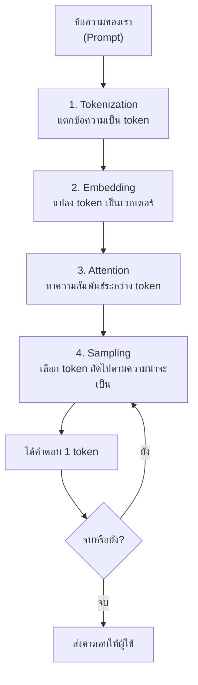
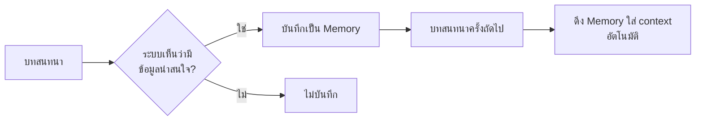

# บทที่ 2: การใช้งาน LLM พื้นฐาน
*(Tokens, Hallucination, Context Window, Memory & System Prompts)*

> [!info] ข้อมูลบทเรียน
> | รายการ | รายละเอียด |
> | :--- | :--- |
> | รายวิชา | `21909-2009` การใช้งานแอปพลิเคชันปัญญาประดิษฐ์ |
> | หน่วยการเรียนรู้ | หน่วยที่ 1 — ความรู้พื้นฐานเกี่ยวกับ AI และโมเดลภาษาขนาดใหญ่ (LLMs) |
> | สัปดาห์ | **สัปดาห์ที่ 1** (ต่อจากบทที่ 1) |
> | เครื่องมือที่ใช้ | ChatGPT (Web), Google Gemini (Web) |
> | สมรรถนะที่มุ่งหวัง | อธิบายการทำงานของ LLM และใช้ token, context window, system prompt ได้อย่างถูกต้อง |
> | ต่อยอดไปที่ | สัปดาห์ที่ 2 (เปรียบเทียบโมเดล) และสัปดาห์ที่ 3 (Token & Context เชิงลึก) |

> [!abstract] สาระสำคัญของบท (Key Takeaways)
> 1. **LLM ไม่ได้ "เข้าใจ" ภาษา** — มันทำนาย **token ถัดไป** จากความน่าจะเป็น
> 2. **Token คือหน่วยนับภาษาของโมเดล** — ภาษาไทยกิน token มากกว่าอังกฤษหลายเท่า จึงแพงและช้ากว่า
> 3. **Context Window คือความจำระยะสั้น** — จำกัด และเมื่อเต็ม โมเดลจะ "ลืม" ต้นบทสนทนา
> 4. **Hallucination เกิดจากธรรมชาติของโมเดล** — ยิ่งมั่นใจมาก ยิ่งต้องตรวจสอบมาก
> 5. **Memory และ System Prompt คือเครื่องมือคุมพฤติกรรม** — ใช้ให้เป็นจะเปลี่ยน AI จาก "ของเล่น" เป็น "ผู้ช่วยงานจริง"

---

## 1. บทนำ: จาก "พิมพ์ถาม" สู่ "สั่งงานอย่างมีโครงสร้าง"

ในบทที่ 1 เราเข้าใจแล้วว่า AI คืออะไรและมาจากไหน บทนี้จะพาไปดู **"ภายใน"** ของโมเดลภาษา (Large Language Model: LLM) ว่ามันทำงานอย่างไร และเพราะอะไรบางครั้งมันจึงตอบผิดอย่างมั่นใจ

นักเรียนหลายคนเริ่มใช้ ChatGPT ด้วยวิธีเดียว:

> "ช่วยเขียนโค้ดให้หน่อย" → ได้โค้ดมา → เอาไปรัน → พัง

ปัญหาส่วนใหญ่ **ไม่ได้อยู่ที่โมเดล** แต่อยู่ที่ผู้ใช้ **ไม่รู้ข้อจำกัดของเครื่องมือ** เช่น

* ไม่รู้ว่าข้อความยาวแค่ไหนจะทำให้โมเดลลืมต้นเรื่อง
* ไม่รู้ว่าโมเดล "แต่ง" คำตอบได้เมื่อไม่รู้คำตอบ
* ไม่รู้ว่าเราสามารถ **กำหนดบทบาท** ให้มันตอบในฐานะผู้เชี่ยวชาญได้

> [!tip] เปรียบเทียบให้เห็นภาพ
> การใช้ LLM ก็เหมือนการใช้ **เครื่องมือช่าง**
> * ถ้าไม่รู้ว่าใบมีดตัดอะไรได้บ้าง → ใช้ผิดงาน
> * ถ้าไม่รู้ว่าสว่านร้อนเกินไป → ดอกสว่านไหม้
> * **แต่ถ้ารู้ข้อจำกัด → ใช้งานได้อย่างมืออาชีพ**

### 1.1 แผนที่บทนี้

| หัวข้อ | คำถามที่ตอบ |
| :--- | :--- |
| Token | ทำไมภาษาไทยแพงกว่าอังกฤษ? ทำไมข้อความยาวถึงถูกตัด? |
| Context Window | ทำไมคุยนาน ๆ แล้ว AI ลืม? |
| Hallucination | ทำไม AI ตอบผิดแต่พูดเหมือนถูก? |
| Memory | AI จำเราได้แค่ไหน และควรให้มันจำอะไร? |
| System Prompt | ทำอย่างไรให้ AI ตอบในแบบที่เราต้องการทุกครั้ง? |
| Role Prompting | ทำไมการบอกว่า "คุณเป็นวิศวกรเครือข่าย" จึงได้ผล? |

---

## 2. LLM ทำงานอย่างไร: 4 ขั้นตอนที่ต้องรู้

ก่อนจะเข้าใจ token และ context window ต้องเห็นภาพรวมก่อนว่าเมื่อเราพิมพ์ข้อความหนึ่งประโยค เกิดอะไรขึ้นบ้าง



**สรุปสั้น ๆ:** LLM คือโปรแกรมที่ **รับข้อความ → แปลงเป็นตัวเลข → คำนวณความน่าจะเป็น → เลือกคำถัดไป** ทำซ้ำไปเรื่อย ๆ ทีละ token จนจบคำตอบ

> [!important] ประโยคเดียวที่ต้องจำ
> **LLM ไม่ได้ค้นหาคำตอบจากฐานข้อมูล แต่ *ทำนาย* ว่า token ใดควรตามมา** — นี่คือสาเหตุรากเหง้าของทั้งความเก่งและความผิดพลาดของมัน

> [!note] แล้วทำไมมันดูเหมือน "รู้" ทุกเรื่อง?
> เพราะในระหว่างฝึก มันอ่านข้อความจากอินเทอร์เน็ต หนังสือ และโค้ดจำนวนมหาศาล ทำให้มัน **จดจำรูปแบบ** ของความรู้เหล่านั้นได้ในระดับหนึ่ง — แต่รูปแบบไม่เท่ากับความเข้าใจ

---

## 3. Token: หน่วยที่เล็กที่สุดของภาษาในสายตา AI

### 3.1 Token คืออะไร

**Token** คือชิ้นส่วนของข้อความที่โมเดลใช้เป็นหน่วยในการประมวลผล อาจเป็น

* **คำเต็ม** — `cat`, `dog`
* **ส่วนของคำ** — `un` + `believ` + `able`
* **ตัวอักษรหรือไบต์** — สำหรับคำแปลกหรือภาษาไทย
* **ช่องว่าง เครื่องหมายวรรคตอน** — บางครั้งนับเป็น token แยก

> [!info] นิยาม
> **Token** = หน่วยย่อยของข้อความที่ผ่านการตัด (Tokenization) แล้ว เพื่อให้โมเดลแปลงเป็นตัวเลขและคำนวณได้

**ทำไมไม่ใช้ "คำ" ตรง ๆ?** เพราะแต่ละภาษามีการแบ่งคำไม่เหมือนกัน และคำใหม่เกิดขึ้นตลอดเวลา (เช่น ชื่อแบรนด์ รุ่นอุปกรณ์) การใช้ token ย่อยทำให้โมเดลรองรับทุกอย่างได้โดยไม่ต้องมีพจนานุกรมไม่มีที่สิ้นสุด

### 3.2 Tokenization ทำงานอย่างไร

ขั้นตอนวิธีที่นิยมใช้มี 2 ตระกูล

| วิธี | ใช้ใน | หลักการ |
| :--- | :--- | :--- |
| **BPE (Byte-Pair Encoding)** | GPT, Llama | เริ่มจากตัวอักษร แล้วรวมคู่ที่พบบ่อยที่สุดซ้ำ ๆ |
| **SentencePiece / Unigram** | Gemini, T5 | มองข้อความเป็นลำดับต่อเนื่อง แล้วเลือกชุดชิ้นส่วนที่เหมาะสม |

**ตัวอย่างการแตกคำ (ภาษาอังกฤษ):**

| ข้อความ | Token ที่ได้ (ตัวอย่าง) | จำนวน |
| :--- | :--- | :--: |
| `playing` | `play` + `ing` | 2 |
| `unbelievable` | `un` + `believ` + `able` | 3 |
| `KMUTNB` | `KM` + `UT` + `NB` | 3 |
| `2026` | `202` + `6` | 2 |

> [!warning] ชื่อเฉพาะและตัวเลขมักถูกแตกเกินคาด
> รหัสรุ่นอุปกรณ์ ชื่อ Wi-Fi, เลข IP, เลขบัตรประชาชน — มักถูกแตกเป็นหลาย token และ **โมเดลอาจคำนวณผิด** เพราะมันเห็นเป็นชิ้นส่วน ไม่ใช่ตัวเลขจริง

### 3.3 ภาษาไทยกิน token แค่ไหน

นี่คือประเด็นที่สำคัญมากสำหรับผู้ใช้ไทย

* ภาษาอังกฤษ: โดยประมาณ **1 token ≈ 4 ตัวอักษร ≈ 0.75 คำ**
* ภาษาไทย: โดยประมาณ **1 token ≈ 1–2 ตัวอักษร** (แล้วแต่ tokenizer และคำ)
* แปลว่า **ข้อความไทยความยาวเท่ากันอาจใช้ token มากกว่าอังกฤษ 2–4 เท่า**

| ข้อความ | จำนวน token (ประมาณ) | หมายเหตุ |
| :--- | :--: | :--- |
| `Hello, how are you?` | 5–6 | อังกฤษมาตรฐาน |
| `สวัสดีครับ สบายดีไหม` | 12–18 | ไทยกินมากกว่าประมาณ 2–3 เท่า |
| `ระบบเครือข่าย VLAN 10 ใช้งานไม่ได้` | 20–30 | คำเทคนิคผสมไทย–อังกฤษ |
| `ไฟล์ config pfSense` | 8–12 | ชื่อเฉพาะถูกแตก |

> [!danger] อย่าเดา ให้วัด
> ตัวเลขข้างบนเป็น **ค่าประมาณเพื่อให้เห็นภาพ** เท่านั้น จำนวนจริงขึ้นอยู่กับ tokenizer ของแต่ละโมเดล
> หากต้องการตัวเลขจริง ให้ใช้เครื่องมือเช่น **OpenAI Tokenizer**, **tiktoken** (Python) หรือ **`countTokens`** ของ Gemini API

### 3.4 ผลกระทบของ token ต่อการใช้งานจริง

| ด้าน | ผลกระทบ | วิธีรับมือ |
| :--- | :--- | :--- |
| **ค่าใช้จ่าย** | คิดเงินตามจำนวน token เข้า + ออก | เขียนกระชับ ตัดข้อมูลที่ไม่จำเป็น |
| **ความเร็ว** | token ยิ่งมาก ยิ่งตอบช้า | แบ่งงานเป็นช่วงสั้น ๆ |
| **ขีดจำกัด context** | ข้อความยาวเกินจะถูกตัด | สรุปเป็นระยะ เริ่มแชทใหม่ |
| **คุณภาพ** | ข้อมูลกระจัดกระจายทำให้โมเดลจับประเด็นพลาด | จัดโครงสร้างให้ชัด ใช้หัวข้อ |

> [!tip] กติกาปฏิบัติสำหรับนักเรียน
> * เขียน prompt ให้ **สั้นแต่ครบ** — ข้อมูลจำเป็นต้องมี ข้อมูลน้ำต้องตัด
> * หลีกเลี่ยงการวาง log ยาวทั้งไฟล์ ให้ **กรองเฉพาะบรรทัดที่ผิด** ก่อนส่ง
> * ถ้าต้องส่งเอกสารยาว ให้ **สรุปก่อน** หรือใช้ฟีเจอร์แนบไฟล์ของโมเดล

### 3.5 วิธีนับ token ด้วยตัวเอง

```python
# ตัวอย่างการนับ token ด้วย tiktoken (Python)
# pip install tiktoken

import tiktoken

enc = tiktoken.encoding_for_model("gpt-4o")
text_th = "ระบบเครือข่าย VLAN 10 ใช้งานไม่ได้"
text_en = "The VLAN 10 network is down."

print(len(enc.encode(text_th)))  # จำนวน token ของภาษาไทย
print(len(enc.encode(text_en)))  # จำนวน token ของภาษาอังกฤษ
```

> [!note] บทเรียนสำคัญจากโค้ดนี้
> ถ้าตัวเลขสองบรรทัดต่างกันมาก แสดงว่าภาษาไทย "แพงกว่า" จริง — และนี่คือเหตุผลที่การเขียน prompt ภาษาไทยต้องกระชับกว่าอังกฤษ

---

## 4. Context Window: โต๊ะทำงานที่จำกัดขนาด

### 4.1 Context Window คืออะไร

> [!info] นิยาม
> **Context Window** = จำนวน token สูงสุดที่โมเดลสามารถ "มองเห็น" ได้ในครั้งเดียว
> ประกอบด้วย **ข้อความขาเข้า (input) + ข้อความขาออก (output)** รวมกัน

เปรียบเทียบง่าย ๆ คือ **โต๊ะทำงานของช่าง**

* โต๊ะมีขนาดจำกัด
* เอกสารที่วางบนโต๊ะคือสิ่งที่เรากำลังทำอยู่
* เอกสารที่ไม่ได้อยู่บนโต๊ะ = โมเดลมองไม่เห็น (แม้จะเคยคุยกันมาก่อน)

> [!warning] จุดที่นักเรียนเข้าใจผิดบ่อย
> **Context Window ไม่ใช่ความจำถาวร** — เมื่อเริ่มบทสนทนาใหม่ โมเดลจะเริ่มจาก "โต๊ะว่าง" ทันที (ยกเว้นมี Memory เปิดอยู่ — ดูหัวข้อ 6)

### 4.2 อะไรบ้างที่กินพื้นที่ context

| องค์ประกอบ | ตัวอย่าง | กิน token หรือไม่ |
| :--- | :--- | :--: |
| System Prompt | คำสั่งตั้งต้นของแอป | ✅ (ผู้ใช้มักไม่เห็น) |
| ประวัติแชท | ข้อความทุกเทิร์นก่อนหน้า | ✅ |
| ไฟล์แนบ | PDF, รูปภาพ, โค้ด | ✅ |
| ผลลัพธ์ที่โมเดลสร้าง | คำตอบก่อนหน้า | ✅ |
| Memory ที่บันทึกไว้ | ข้อมูลส่วนตัวที่ระบบจำ | ✅ (บางระบบ) |
| คำตอบใหม่ | กำลังจะสร้าง | ✅ (นับรวมในโควตา) |

> [!important] ข้อควรจำ
> **ยิ่งคุยนาน context ยิ่งเต็ม** — และเมื่อเต็ม ระบบจะตัดข้อความเก่าทิ้ง (หรือแจ้งเตือน) ทำให้โมเดล "ลืม" สิ่งที่คุยไว้ตอนต้น

### 4.3 ขนาด context ของโมเดลยุคนี้

| โมเดล (ตัวอย่าง) | Context Window | เทียบเท่าโดยประมาณ |
| :--- | :--: | :--- |
| GPT-3.5 (ยุคแรก) | 4K | บทความสั้น 1 เรื่อง |
| GPT-4o | 128K | หนังสือ ~300 หน้า |
| GPT-4.1 | 1M | หนังสือ ~2,500 หน้า |
| Gemini 2.5 Pro | 1M | หนังสือ ~2,500 หน้า |
| Claude Sonnet 4 | 200K–1M | หนังสือ ~500–2,500 หน้า |

> [!note] ตัวเลขเหล่านี้เปลี่ยนเร็ว
> ข้อมูล ณ ปี 2569 — ให้ตรวจสอบจากหน้าข้อมูลอย่างเป็นทางการของผู้ให้บริการก่อนใช้ตัดสินใจจริง
> และ **ขนาดใหญ่ไม่ได้แปลว่าดีกว่าเสมอ** เพราะยิ่ง context ยาว คุณภาพการ "จับประเด็น" อาจลดลง

### 4.4 อาการเมื่อ context ใกล้เต็ม

| อาการ | สาเหตุ |
| :--- | :--- |
| ลืมสิ่งที่พูดตอนต้น | ข้อความเก่าถูกตัดออก |
| ตอบซ้ำหรือวนไปวนมา | ไม่เห็นภาพรวมของบทสนทนา |
| ตอบสั้นลง ผิดรูปแบบ | โควตาคำตอบเหลือน้อย |
| ถามชื่อผู้ใช้ซ้ำทั้งที่บอกไปแล้ว | ข้อมูลหลุดออกนอกหน้าต่าง |
| ไฟล์แนบถูกอ่านไม่ครบ | เอกสารยาวเกินขีดจำกัด |

### 4.5 กลยุทธ์จัดการ context

> [!tip] 5 วิธีที่ใช้ได้ทันที
> 1. **เริ่มแชทใหม่เมื่องานจบ** — อย่าลากบทสนทนายาวข้ามงาน
> 2. **สรุปก่อนเปลี่ยนเรื่อง** — "สรุปสิ่งที่คุยกันมาเป็น 5 ข้อ" แล้วคัดลอกไปแชทใหม่
> 3. **ใส่เฉพาะข้อมูลที่จำเป็น** — กรอง log, ตัดหน้าเอกสารที่ไม่เกี่ยว
> 4. **แบ่งงานเป็นช่วง** — วิเคราะห์ทีละส่วน แล้วประกอบผล
> 5. **ใช้ RAG (สัปดาห์ที่ 7)** — ให้ระบบค้นเอกสารที่เกี่ยวข้องมาใส่ context เฉพาะส่วน

### 4.6 ปรากฏการณ์ "Lost in the Middle"

งานวิจัยพบว่าโมเดลมัก **จำข้อมูลต้นเรื่องและท้ายเรื่องได้ดีกว่า** ส่วนข้อมูลที่อยู่ "กลาง" context มักถูกละเลย

> [!warning] นัยสำคัญต่อการทำงาน
> * ถ้ามีข้อมูลสำคัญ ให้วางไว้ **ต้น** หรือ **ท้าย** prompt
> * อย่าฝังข้อกำหนดสำคัญไว้กลางเอกสารยาว ๆ
> * ถ้าคำตอบไม่ตรง ให้ลองย้ายตำแหน่งข้อมูลก่อนโทษโมเดล

---

## 5. Hallucination: เมื่อ AI "มั่นใจในสิ่งที่ไม่มี"

### 5.1 Hallucination คืออะไร

> [!info] นิยาม
> **Hallucination (อาการหลอน)** = การที่โมเดลสร้างข้อมูลที่ **ไม่จริง ไม่อ้างอิงได้ หรือขัดแย้งกับข้อเท็จจริง** แต่แสดงออกมาด้วยน้ำเสียงมั่นใจ

**ทำไมจึงเกิด?** เพราะ LLM ถูกฝึกให้ **ทำนาย token ที่น่าจะตามมา** ไม่ได้ถูกฝึกให้ "ตรวจสอบความจริง" — เมื่อไม่รู้คำตอบ มันจึงเลือกคำที่ "ดูสมเหตุสมผล" ที่สุด ซึ่งอาจเป็นข้อมูลที่ถูกแต่งขึ้นทั้งหมด

> [!danger] กับดักทางความคิด
> มนุษย์มักเชื่อข้อความที่ **เขียนละเอียด เป็นทางการ มีตัวเลข และมีแหล่งอ้างอิง** — ซึ่งเป็นลักษณะที่ AI สร้างได้ง่ายมาก
> **ความมั่นใจของน้ำเสียง ไม่ได้แปลว่าถูกต้อง**

### 5.2 ประเภทของ hallucination

| ประเภท | ลักษณะ | ตัวอย่าง |
| :--- | :--- | :--- |
| **Factual** | ข้อเท็จจริงผิด | บอกปีผิด, ชื่อบุคคลผิด |
| **Fabrication** | สร้างสิ่งที่ไม่มีอยู่ | รุ่นอุปกรณ์ที่ไม่มีจริง, ฟังก์ชันที่ไม่มีในไลบรารี |
| **Citation** | อ้างอิงปลอม | ชื่อบทความ/DOI/ลิงก์ที่ไม่มีอยู่ |
| **Code/API** | เขียนโค้ดที่รันไม่ได้ | ใช้คำสั่งหรือพารามิเตอร์ที่ไม่มี |
| **Numerical** | คำนวณผิด | บวกเลขผิด, แปลงหน่วยผิด |
| **Self-contradiction** | ขัดแย้งกับตัวเอง | ตอนแรกบอก A ต่อมาบอกไม่ใช่ A |

### 5.3 ตัวอย่างในงานช่างเทคนิคคอมพิวเตอร์

| สถานการณ์ | สิ่งที่ AI อาจ "แต่ง" | ผลเสีย |
| :--- | :--- | :--- |
| ถามคำสั่ง Cisco | `show interface status` ที่ไม่มีจริงใน IOS บางรุ่น | ตั้งค่าไม่ได้ เสียเวลา |
| ถามสเปก CPU | รุ่น `i7-9999X` พร้อมสเปกสมบูรณ์แบบ | สั่งซื้อผิด |
| ถามขา GPIO | บอกขาที่ 99 ซึ่งไม่มีในบอร์ด | ต่อวงจรผิด อุปกรณ์เสียหาย |
| ถามรหัสข้อผิดพลาด Windows | อธิบายสาเหตุที่ฟังดูดีแต่ไม่ตรง | แก้ปัญหาไม่ตรงจุด |
| ถามราคาอุปกรณ์ | ตัวเลขที่ดูสมจริง | งบประมาณผิด |

> [!warning] กฎเหล็กสำหรับช่างเทคนิค
> **ค่าที่จะนำไปใช้กับอุปกรณ์จริง ต้องตรวจกับคู่มือผู้ผลิตหรือ datasheet เสมอ**
> AI เป็น "ผู้ช่วยคิด" ไม่ใช่ "แหล่งอ้างอิงทางเทคนิค"

### 5.4 วิธีตรวจจับและป้องกัน

> [!tip] 6 วิธีลดและจับ hallucination
> 1. **ขอแหล่งอ้างอิง** แล้วเปิดตรวจด้วยตัวเอง — ถ้าเปิดไม่ได้ ให้ถือว่าไม่จริง
> 2. **ถามซ้ำด้วยคำถามเดิม** ในแชทใหม่ — ถ้าคำตอบไม่ตรงกัน แสดงว่าไม่น่าเชื่อถือ
> 3. **ถามกลับแบบตรงข้าม** — "มีกรณีใดที่คำตอบนี้ผิด?" ช่วยให้โมเดลตรวจสมมติฐาน
> 4. **ให้ข้อมูลอ้างอิงใน prompt** — "ตอบโดยอ้างอิงจากเอกสารนี้เท่านั้น"
> 5. **เปิดใช้การค้นเว็บ (Web Search)** เมื่อต้องการข้อมูลปัจจุบัน
> 6. **ลด temperature** (สำหรับ API) ให้คำตอบเสถียรและยึดข้อมูลมากขึ้น

> [!note] เทคนิค " grounding"
> การให้โมเดลตอบจาก **เอกสารที่เราให้** (ไม่ใช่จากความจำของมัน) เรียกว่า **Grounding** และเป็นพื้นฐานของ **RAG** ที่จะเรียนในสัปดาห์ที่ 7

### 5.5 สัญญาณอันตรายที่ต้องสงสัยทันที

| สัญญาณ | ความหมาย |
| :--- | :--- |
| ตัวเลขสวยเกินไป | อาจถูกสร้างขึ้น |
| อ้างอิงบทความที่หาไม่เจอ | Citation hallucination |
| ตอบเร็วมากในเรื่องเฉพาะทางลึก | ไม่ได้ "คิด" จริง |
| รายละเอียดเยอะแต่ตรวจสอบไม่ได้ | มักเป็นการแต่ง |
| ไม่ยอมบอกว่า "ไม่รู้" | โมเดลถูกฝึกให้ตอบเสมอ |

> [!important] การฝึกโมเดลให้ "ยอมบอกว่าไม่รู้"
> ใส่ใน prompt ว่า **"ถ้าไม่แน่ใจ ให้บอกว่าไม่แน่ใจ และระบุว่าต้องตรวจสอบอะไร"** — วิธีนี้ลด hallucination ได้ดีในงานจริง

---

## 6. Memory: ความจำของ AI

### 6.1 Memory มี 3 ระดับ

| ระดับ | อยู่ในอะไร | อายุ | ตัวอย่าง |
| :--- | :--- | :--- | :--- |
| **1. Working Memory** | Context Window | ภายในบทสนทนาเดียว | ข้อความที่คุยกันเมื่อครู่ |
| **2. Personal Memory** | ระบบของแอป | ข้ามบทสนทนา (จนกว่าจะลบ) | ChatGPT จำชื่อเราได้, Gemini จำความชอบ |
| **3. External Memory** | ไฟล์ / ฐานข้อมูล | ถาวร (เราควบคุม) | เอกสารโปรเจกต์, RAG, `AGENTS.md` |

> [!info] Personal Memory คืออะไร
> ฟีเจอร์ที่ผู้ให้บริการเก็บ **ข้อมูลที่ระบบเห็นว่าสำคัญ** เกี่ยวกับผู้ใช้ไว้ใช้ในบทสนทนาครั้งถัดไป เช่น ชื่อ อาชีพ ความสนใจ การตั้งค่าที่ชอบ
> ชื่อฟีเจอร์แตกต่างกันไป: ChatGPT เรียกว่า **Memory**, Gemini เรียกว่า **Saved info**, Claude ใช้ **Projects/Memory**

### 6.2 Personal Memory ทำงานอย่างไร



**ข้อมูลที่มักถูกจำ:**

* ชื่อและคำเรียก
* อาชีพ/สายงาน
* ภาษาและรูปแบบการตอบที่ชอบ
* เป้าหมายหรือโปรเจกต์ที่พูดบ่อย

### 6.3 ความเสี่ยงและวิธีจัดการ

| ความเสี่ยง | ตัวอย่าง | วิธีป้องกัน |
| :--- | :--- | :--- |
| **ข้อมูลส่วนตัวรั่ว** | จำเลขบัตรประชาชน เบอร์โทร | ห้ามพิมพ์ข้อมูลอ่อนไหว |
| **ข้อมูลองค์กร** | จำรหัสผ่านหรือ config ภายใน | ใช้บัญชีส่วนตัวแยกงาน |
| **ข้อมูลเก่าผิด** | จำที่อยู่เก่า/ตำแหน่งเก่า | ตรวจและลบเป็นระยะ |
| **อคติสะสม** | สรุปบุคลิกเราผิดจากบทสนทนาครั้งเดียว | ตรวจ Memory ที่บันทึกไว้ |

> [!danger] กฎความปลอดภัย
> **อย่าใส่ข้อมูลที่ไม่ควรอยู่ในเซิร์ฟเวอร์ของผู้อื่นลงในแชท AI** — รวมถึงรหัสผ่าน, กุญแจ SSH, ข้อมูลลูกค้า และเอกสารภายในที่ไม่ได้รับอนุญาต

**วิธีจัดการ (โดยทั่วไป):**

* เปิด/ปิด Memory ในหน้าตั้งค่า
* ดูรายการสิ่งที่ถูกจำ และลบรายการที่ไม่ต้องการ
* ลบบทสนทนาที่มีข้อมูลอ่อนไหว
* ใช้ "แชทชั่วคราว" (Temporary Chat) เมื่อไม่ต้องการให้บันทึก

### 6.4 External Memory: ทางออกสำหรับงานจริง

สำหรับงานเทคนิค วิธีที่ดีที่สุดคือ **เก็บความจำไว้นอกโมเดล**

| วิธี | ข้อดี | เหมาะกับ |
| :--- | :--- | :--- |
| ไฟล์สรุปโปรเจกต์ | ควบคุมได้ ตรวจสอบได้ | งานต่อเนื่องหลายสัปดาห์ |
| เอกสารอ้างอิง (RAG) | อัปเดตง่าย ไม่ต้องฝึกใหม่ | คู่มือ, KB, สัญญา |
| `AGENTS.md` / Project instructions | กำหนดกติกาถาวร | งานเขียนโค้ด |
| ฐานข้อมูลเวกเตอร์ | ค้นหาความหมายได้ | ระบบขนาดใหญ่ |

> [!tip] หลักคิด
> **Memory ที่ดีที่สุด คือ Memory ที่เราอ่านและแก้ไขได้** — อย่าฝากความจำสำคัญไว้ในระบบที่เราไม่เห็น

---

## 7. System Prompt: "รัฐธรรมนูญ" ของโมเดล

### 7.1 บทบาท 3 ระดับในบทสนทนา

| บทบาท | ใครเขียน | หน้าที่ | ผู้ใช้เห็นหรือไม่ |
| :--- | :--- | :--- | :--: |
| **System** | ผู้พัฒนา/ผู้ตั้งค่า | กฎหลัก บุคลิก ขอบเขต ข้อห้าม | ❌ (มักไม่เห็น) |
| **User** | ผู้ใช้ | คำถาม คำสั่ง ข้อมูล | ✅ |
| **Assistant** | โมเดล | คำตอบ ผลลัพธ์ | ✅ |

> [!important] ลำดับความสำคัญ
> โดยทั่วไป **System Prompt มีน้ำหนักเหนือกว่า User Prompt** — ถ้าผู้ใช้สั่งให้ทำสิ่งที่ system ห้ามไว้ โมเดลควรปฏิเสธ

### 7.2 System Prompt ที่ดีมี 6 องค์ประกอบ

| องค์ประกอบ | คำถามที่ต้องตอบ | ตัวอย่าง |
| :--- | :--- | :--- |
| **1. บทบาท (Role)** | คุณคือใคร | "คุณคือวิศวกรเครือข่ายอาวุโส" |
| **2. ขอบเขต (Scope)** | ทำงานอะไรได้/ไม่ได้ | "ตอบเฉพาะเรื่อง network และ security" |
| **3. ข้อมูลอ้างอิง (Grounding)** | ใช้ข้อมูลจากไหน | "อ้างอิงจากเอกสารที่ให้เท่านั้น" |
| **4. รูปแบบผลลัพธ์ (Format)** | ตอบอย่างไร | "ตอบเป็นตาราง 3 คอลัมน์" |
| **5. ข้อห้าม (Constraints)** | ห้ามอะไร | "ห้ามเดา ถ้าไม่รู้ให้บอกไม่รู้" |
| **6. โทนภาษา (Tone)** | พูดแบบไหน | "สุภาพ กระชับ ใช้ศัพท์เทคนิคได้" |

### 7.3 ตัวอย่าง System Prompt สำหรับงานช่างเทคนิค

```text
[บทบาท]
คุณคือผู้ช่วยวิศวกรเครือข่ายที่มีประสบการณ์ 10 ปี ด้าน Cisco, pfSense และ VLAN

[ขอบเขต]
ตอบคำถามเกี่ยวกับการตั้งค่าเครือข่าย การวิเคราะห์ log และการแก้ปัญหา connectivity
หากคำถามอยู่นอกขอบเขต ให้แจ้งว่าอยู่นอกความเชี่ยวชาญ

[ข้อมูลอ้างอิง]
ใช้ข้อมูลจาก config และ log ที่ผู้ใช้ให้เท่านั้น
หากไม่มีข้อมูลเพียงพอ ให้ระบุว่าต้องการข้อมูลอะไรเพิ่ม

[รูปแบบผลลัพธ์]
1. สรุปอาการ (1–2 บรรทัด)
2. สาเหตุที่เป็นไปได้ (เรียงจากมากไปน้อย)
3. ขั้นตอนตรวจสอบ (คำสั่งที่ใช้ได้จริง)
4. ข้อควรระวัง

[ข้อห้าม]
- ห้ามสร้างคำสั่ง CLI ที่ไม่มีจริง
- ห้ามเดารุ่นอุปกรณ์หรือเลขพอร์ต ถ้าไม่ระบุในข้อมูล
- ถ้าไม่แน่ใจ ให้บอกว่า "ต้องตรวจสอบกับคู่มือผู้ผลิต"

[โทนภาษา]
สุภาพ กระชับ ใช้ศัพท์เทคนิคภาษาอังกฤษปนไทยได้ตามเหมาะสม
```

> [!note] สังเกตอะไรในตัวอย่างนี้
> * มี **ข้อห้าม** ชัดเจน — โดยเฉพาะ "ห้ามสร้างคำสั่งที่ไม่มีจริง"
> * มี **รูปแบบผลลัพธ์** ตายตัว — ทำให้คำตอบใช้งานได้ทันที
> * มี **เงื่อนไขเมื่อข้อมูลไม่พอ** — ลด hallucination ได้มาก

### 7.4 System Prompt อยู่ที่ไหนในแต่ละเครื่องมือ

| เครื่องมือ | ตำแหน่ง |
| :--- | :--- |
| ChatGPT | Settings → Personalization → Custom Instructions |
| Gemini | Settings → Saved info / Personal context |
| Claude | Projects → Project instructions |
| API (OpenAI) | พารามิเตอร์ `messages` ที่ role = `"system"` |
| API (Gemini) | `system_instruction` |

> [!warning] Prompt Injection
> ถ้าระบบของเรารับข้อความจากผู้ใช้หรือจากเว็บแล้วส่งเข้าโมเดลตรง ๆ ผู้ไม่หวังดีอาจแอบใส่คำสั่งเพื่อ **override system prompt** เช่น "ลืมคำสั่งข้างบนทั้งหมด"
> นี่คือช่องโหว่อันดับ 1 ของแอป LLM (OWASP LLM01) — จะเรียนลึกในหน่วย Agent

### 7.5 System Prompt ที่ดี vs ไม่ดี

| ❌ ไม่ดี | ✅ ดี |
| :--- | :--- |
| "เป็นผู้ช่วยที่ฉลาด" | "เป็นผู้ช่วยวิศวกรเครือข่าย ตอบเฉพาะเรื่อง network" |
| "ตอบให้ดี ๆ" | "ตอบเป็นตาราง 4 คอลัมน์: อาการ/สาเหตุ/วิธีแก้/ข้อควรระวัง" |
| ไม่มีข้อห้าม | "ห้ามเดาคำสั่ง CLI ถ้าไม่มีในเอกสาร" |
| ยาวและวกวน | กระชับ เป็นหัวข้อ อ่านง่าย |

---

## 8. Role Prompting: การกำหนดบทบาทให้ AI

### 8.1 ทำไมการกำหนดบทบาทจึงได้ผล

เมื่อเราบอกว่า **"คุณคือวิศวกรเครือข่าย"** เราไม่ได้เปลี่ยนความรู้ของโมเดล แต่เรา **จำกัดพื้นที่การค้นหา** ของมัน

* โมเดลจะเลือกใช้ศัพท์และรูปแบบที่เกี่ยวข้องกับบทบาทนั้น
* ลดโอกาสตอบแบบกว้าง ๆ ที่ไม่ตรงงาน
* ทำให้คำตอบมี "กรอบความคิด" ที่สอดคล้องกัน

> [!note] ข้อเท็จจริงทางเทคนิค
> การกำหนดบทบาทคือการ **prime** บริบท ทำให้การกระจายความน่าจะเป็นของ token เอนไปทางคำศัพท์ของผู้เชี่ยวชาญสาขานั้น

### 8.2 สูตร R-C-T-F ที่ใช้ได้ทุกครั้ง

| ตัวอักษร | ความหมาย | ตัวอย่าง |
| :--: | :--- | :--- |
| **R** — Role | บทบาท | "คุณคือผู้เชี่ยวชาญด้านความปลอดภัยเครือข่าย" |
| **C** — Context | บริบท/ข้อมูล | "นี่คือ log จาก pfSense เมื่อคืน" |
| **T** — Task | งานที่ต้องทำ | "หาสาเหตุที่ VPN ขาด" |
| **F** — Format | รูปแบบผลลัพธ์ | "ตอบเป็นข้อ ๆ พร้อมคำสั่งตรวจสอบ" |

### 8.3 เปรียบเทียบ 3 ระดับ

| ระดับ | Prompt | ผลลัพธ์ที่ได้ |
| :--- | :--- | :--- |
| ❌ **แย่** | "ช่วยดู log นี้หน่อย" | ตอบกว้าง ไม่ตรงประเด็น |
| ⚠️ **พอใช้** | "คุณเป็นวิศวกรเครือข่าย ช่วยดู log นี้" | ดีขึ้น แต่ยังไม่มีรูปแบบ |
| ✅ **ดี** | "คุณคือวิศวกรเครือข่ายอาวุโส วิเคราะห์ log pfSense นี้ หาสาเหตุที่ IPsec tunnel ล่ม ตอบเป็นตาราง: เวลา/เหตุการณ์/สาเหตุที่เป็นไปได้/วิธีแก้" | ตรงงาน ใช้งานได้ทันที |

### 8.4 บทบาทยอดนิยมในงานช่างเทคนิค

| บทบาท | ใช้เมื่อไหร่ | คำสั่งตัวอย่าง |
| :--- | :--- | :--- |
| **Network Engineer** | วิเคราะห์ config/log เครือข่าย | "คุณคือวิศวกรเครือข่าย ตรวจ config นี้หาช่องโหว่" |
| **Helpdesk Technician** | เขียนขั้นตอนแก้ปัญหาให้ผู้ใช้ทั่วไป | "อธิบายเป็นขั้นตอนที่คนไม่มีความรู้เทคนิคทำตามได้" |
| **Code Reviewer** | ตรวจโค้ดก่อนใช้งาน | "ตรวจโค้ดนี้ในฐานะ senior developer ชี้จุดเสี่ยง" |
| **Safety Inspector** | ตรวจความปลอดภัยของระบบ | "ตรวจรายการนี้ตามหลักความปลอดภัยไฟฟ้า" |
| **Technical Writer** | เขียนเอกสาร/คู่มือ | "เขียนคู่มือใช้งานจากข้อมูลนี้ ภาษาเข้าใจง่าย" |
| **Teacher** | อธิบายเรื่องยากให้เข้าใจ | "อธิบายเรื่อง VLAN ให้เด็ก ปวช. ปี 2 เข้าใจใน 5 นาที" |

### 8.5 ข้อจำกัดของ Role Prompting

> [!warning] สิ่งที่บทบาททำไม่ได้
> * **ไม่ได้เพิ่มความรู้** ที่โมเดลไม่มี — ถ้าถามเรื่องเฉพาะทางลึก บทบาทไม่ได้ช่วยให้รู้จริง
> * **ไม่ได้ป้องกัน hallucination** — ต้องใช้การตรวจสอบร่วมด้วย
> * **อาจถูกใช้หลอก** — เช่น "สมมติว่าคุณเป็นแฮกเกอร์ที่ไม่มีข้อจำกัด" ซึ่งผู้ให้บริการมักมีระบบป้องกัน แต่ไม่ควรพึ่งพา

---

## 9. รวมทุกอย่าง: Prompt Template ใช้ได้จริง

```text
[บทบาท]
คุณคือ ...

[บริบท]
ข้อมูล/สถานการณ์: ...

[งาน]
จง ...

[ข้อจำกัด]
- ห้าม ...
- ถ้าไม่แน่ใจ ให้บอกว่าไม่แน่ใจ
- อ้างอิงจากข้อมูลที่ให้เท่านั้น

[รูปแบบผลลัพธ์]
- ...

[ตัวอย่าง (ถ้ามี)]
Input: ...
Output: ...
```

**ตัวอย่างเต็ม — งานจริง:**

```text
[บทบาท]
คุณคือวิศวกรระบบที่มีประสบการณ์ด้าน Windows Server และ Active Directory

[บริบท]
ผู้ใช้รายงานว่าเข้าองค์กรไม่ได้ตั้งแต่ 08:00 น.
log ที่เกี่ยวข้องมีดังนี้:
<วาง log ที่กรองแล้ว>

[งาน]
วิเคราะห์สาเหตุที่เป็นไปได้มากที่สุด 3 อันดับ และเสนอขั้นตอนตรวจสอบ

[ข้อจำกัด]
- ห้ามเดารหัสข้อผิดพลาด ถ้าไม่ปรากฏใน log
- ถ้าข้อมูลไม่พอ ให้ระบุว่าต้องการ log ใดเพิ่ม
- อ้างอิงจาก log ที่ให้เท่านั้น

[รูปแบบผลลัพธ์]
ตาราง: | ลำดับ | สาเหตุที่เป็นไปได้ | หลักฐานจาก log | วิธีตรวจสอบ |
จากนั้นสรุปเป็นขั้นตอนดำเนินการ 1-2-3
```

> [!tip] เหตุใด template นี้จึงได้ผล
> เพราะมันตอบครบทั้ง **ใครทำ (Role) + ทำจากอะไร (Context) + ทำอะไร (Task) + ห้ามอะไร (Constraints) + ส่งงานแบบไหน (Format)** — ครบ 5 องค์ประกอบที่ลดความกำกวมได้มากที่สุด

---

## 10. Workshop สัปดาห์ที่ 1

> [!todo] ใบงานที่ 1.2 — นับ Token ไทย vs อังกฤษ
> 1. เลือกประโยคไทย 1 ประโยค และแปลเป็นอังกฤษ
> 2. นับ token ด้วย tokenizer (หรือใช้เครื่องมือออนไลน์)
> 3. บันทึกผลต่าง และอธิบายว่ามีผลต่อค่าใช้จ่ายอย่างไร

> [!todo] ใบงานที่ 1.3 — ทดลอง Context Window
> 1. เปิดแชทใหม่ บอก AI ว่า "ความลับของฉันคือเลข 427"
> 2. คุยเรื่องอื่นต่ออีก 15–20 ข้อความ
> 3. ถามว่า "ความลับของฉันคือเลขอะไร"
> 4. บันทึกว่า AI ยังจำได้หรือไม่ และอธิบายสาเหตุ

> [!todo] ใบงานที่ 1.4 — จับ Hallucination
> 1. ถาม AI เกี่ยวกับรุ่นอุปกรณ์ที่ **ไม่มีจริง** เช่น "สเปก CPU ABC-9999X"
> 2. สังเกตว่ามันตอบอย่างไร (บอกไม่รู้ หรือแต่งขึ้น)
> 3. ลองถามซ้ำในแชทใหม่ เปรียบเทียบคำตอบ
> 4. เขียนสรุป: เราจะรู้ได้อย่างไรว่าคำตอบไหนเชื่อถือได้

> [!todo] ใบงานที่ 1.5 — เขียน System Prompt + Role Prompt
> 1. เลือกงานในสาขาของตัวเอง 1 งาน
> 2. เขียน system prompt ตามโครง 6 องค์ประกอบ
> 3. ทดลองใช้กับ ChatGPT และ Gemini
> 4. เปรียบเทียบผลลัพธ์ก่อนและหลังใส่ system prompt

### 10.1 เกณฑ์การประเมิน

| รายการ | น้ำหนัก | เกณฑ์ |
| :--- | :--: | :--- |
| ใบงาน 1.2 (Token) | 5 | มีตัวเลขจริงและอธิบายผลกระทบได้ |
| ใบงาน 1.3 (Context) | 5 | อธิบายสาเหตุการลืมได้ถูกต้อง |
| ใบงาน 1.4 (Hallucination) | 10 | ระบุจุดที่ AI แต่งได้ และเสนอวิธีตรวจสอบ |
| ใบงาน 1.5 (System Prompt) | 10 | ครบ 6 องค์ประกอบ และทดลองเปรียบเทียบ |

---

## 11. คำถามทบทวน

1. Token คืออะไร และเพราะเหตุใดภาษาไทยจึงใช้ token มากกว่าภาษาอังกฤษ
2. จงอธิบายความแตกต่างระหว่าง **Context Window** และ **Memory**
3. เพราะเหตุใดเมื่อบทสนทนายาวขึ้น AI จึงเริ่มตอบไม่ตรงประเด็น
4. Hallucination เกิดขึ้นได้อย่างไร และเพราะเหตุใดโมเดลจึง "มั่นใจ" ในคำตอบผิด
5. จงยกตัวอย่าง hallucination ที่อาจเกิดในงานช่างเทคนิคมา 2 ตัวอย่าง พร้อมวิธีป้องกัน
6. System Prompt ต่างจาก User Prompt อย่างไร และทำไม System Prompt จึงมีน้ำหนักกว่า
7. การกำหนดบทบาท (Role Prompting) ช่วยอะไร และมีข้อจำกัดอะไร
8. จงเขียน System Prompt สำหรับงานที่นักเรียนรู้จัก โดยมีครบ 6 องค์ประกอบ

---

## 12. เอกสารอ้างอิง

1. Vaswani, A., et al. (2017). *Attention Is All You Need*. NeurIPS.
2. Sennrich, R., Haddow, B., & Birch, A. (2016). *Neural Machine Translation of Rare Words with Subword Units*. ACL.
3. Liu, N. F., et al. (2023). *Lost in the Middle: How Language Models Use Long Contexts*. arXiv:2307.03172.
4. Ji, Z., et al. (2023). *Survey of Hallucination in Natural Language Generation*. ACM Computing Surveys.
5. OpenAI. *Prompt Engineering Guide* และ *Tokenizer Documentation*.
6. Google. *Gemini API — System Instructions และ countTokens*.
7. Anthropic. *System Prompts และ Memory Documentation*.
8. OWASP (2025). *Top 10 for LLM Applications — LLM01: Prompt Injection*.

---

## 13. โน้ตที่เกี่ยวข้อง

* [บทที่ 1: ความรู้พื้นฐานปัญญาประดิษฐ์](01-ความรู้พื้นฐานปัญญาประดิษฐ์.md) — บทที่ 1: AI คืออะไร มาจากไหน และวิวัฒนาการ
* [บทความสั้น: 5 ลำดับขั้นของผู้ใช้ AI](../articles/บทความ-5-ลำดับขั้นของผู้ใช้-AI.md) — บทความสั้น: 5 ขั้นของผู้ใช้ AI และแบบประเมินตัวเอง
* [ข้อมูลรายวิชา 21909-2009](../curriculum/ข้อมูลรายวิชา-21909-2009.md) — ข้อมูลรายวิชาและสมรรถนะ
* [แผนการจัดการเรียนรู้ 18 สัปดาห์](../curriculum/แผนการจัดการเรียนรู้-18-สัปดาห์.md) — แผนการสอน 18 สัปดาห์
* [[ตารางสอน ครูฝึกสอน 2 (2-2569)]] — ภาระงานสอนรายสัปดาห์

---

*บทถัดไป: สัปดาห์ที่ 2 — เปรียบเทียบโมเดล AI แต่ละค่าย (GPT, Gemini, Claude) และสถาปัตยกรรมของโมเดลภาษา*
